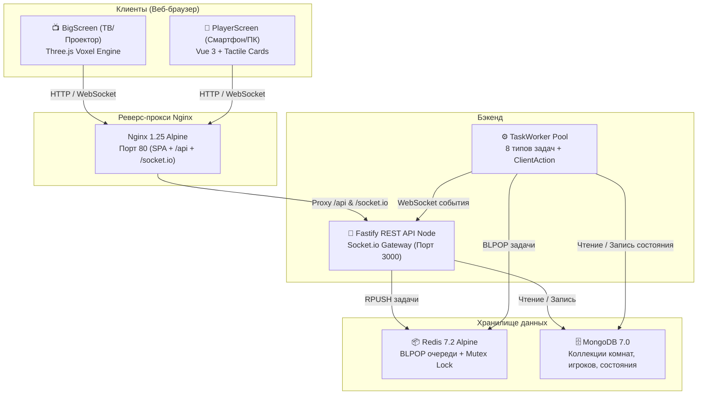

# ☢️ BUNKER-disco

> **BUNKER-disco** — это высокотехнологичная мультиплеерная PC-адаптация настольной игры «Бункер» в формате Jackbox Party. Игра выводит интерактивную трёхмерную воксельную сцену на большой экран (ТВ или проектор), а участники подключаются со своих смартфонов или ПК через веб-браузер по 5-значному коду комнаты.

---

## 🎮 Ключевые особенности

- 📺 **Большой экран (BigScreen)**:
  - Трёхмерный воксельный движок на **Three.js** с рендерингом через `THREE.InstancedMesh` (<30 draw calls);
  - **Фаза 1 (Отбор у входа)**: Хвойный лес, мерцающий костёр, гермошлюз бункера, амфитеатр игроков до 20 человек в 2 яруса;
  - **Туман войны (Fog of War)**: Процедурный GLSL-шейдер, скрывающий подземные уровни бункера; при раскрытии комнат прожигает световые шахты и анимирует падение модулей;
  - **Фаза 2 (Выживание внутри)**: Герметизация шлюза, переход персонажей в рабочие отсеки бункера, визуализация поломок, пожаров и аварий;
  - **Camera Director**: 5 автоматических операторских пресетов (панорама леса, фокус на выступающем ораторе, арена дебатов, изометрия бункера, аварийный трекинг).
- 📱 **Экран игрока (PlayerScreen)**:
  - Ретро-пиксельный интерфейс (CRT-стилистика, шрифты Press Start 2P / Silkscreen);
  - **Тактильный Card Vibe**: 3D-переворот карточек (`rotateY`), голографический перелив при наклоне смартфона (гироскоп `DeviceOrientation` / мышь), досье соперников с бронированными рубашками `[LOCKED]`;
  - **Механика Mulligan**: Настраиваемый перерандом руки (`rerollLimit`) с анимацией разрыва карточек;
  - **Экономика 3 AP**: Очки действий на раунд (добровольные вскрытия, активные способности, вето на изгнание).
- 🧠 **Автоматический Ведущий (PC Game Master)**:
  - Автоматический контроль таймеров дебатов, очередей выступлений и голосований;
  - Строгий инвариант вместимости бункера: **$K = \lfloor N / 2 \rfloor$** (при 20 игроках — 10 мест, при 7 игроках — 3 места);
  - Разрешение ничьих: быстрый переголос, а при повторной ничьей — криптографическая рулетка ведущего.
- 🃏 **Полный перенос колод (586 карточек)**:
  - Классический «Бункер 3.1» и официальные дополнения (включая «Поколение Альфа»);
  - Чёткое тегирование карточек: `[BASE]`, `[ALPHA]`, `[EXPANSION]`, `[NEW]`;
  - Тумблеры колод в настройках лобби: `enableSuperpowers` (по умолчанию `false`), `enablePhobias` (`true`), `enableCharacter` (`true`).
- 🛠️ **Инженерия и надежность**:
  - **CQRS-Lite**: Разделение REST API (Fastify) и пула воркеров через Redis BLPOP очереди и распределённые блокировки (`DistributedLock`);
  - **100% покрытие автотестами**: 49 тестовых файлов, **304 automated tests** проходят (Unit, Integration, E2E Tier 1 Features, Tier 2 Boundaries).

---

## 🏗️ Архитектура системы



---

## 🚀 Быстрый старт (Docker Compose)

Запуск всей экосистемы (5 сервисов) выполняется одной командой:

```bash
# 1. Склонируйте репозиторий и перейдите в папку
cd c:/Папки/коды/BUNKER-disco

# 2. Создайте файл переменных окружения (если отсутствует)
cp .env.example .env

# 3. Соберите и запустите все 5 контейнеров
docker compose up -d --build
```

После старта перейдите в браузере:
- **Главное меню**: [http://localhost/](http://localhost/)
- **Большой экран (ТВ/Проектор)**: [http://localhost/screen](http://localhost/screen)
- **Экран игрока (Смартфон/ПК)**: [http://localhost/play](http://localhost/play)
- **REST API & Swagger Docs**: [http://localhost:3000/docs](http://localhost:3000/docs)
- **Healthcheck проверки**: [http://localhost:3000/api/v1/health](http://localhost:3000/api/v1/health)

---

## 💻 Локальная разработка без Docker

### Требования
- Node.js 20+
- Redis 7+ (`localhost:6379`)
- MongoDB 7+ (`localhost:27017`)

### Установка и запуск

```bash
# 1. Установка всех зависимостей монорепозитория
npm install

# 2. Сборка всех пакетов (@bunker/shared, @bunker/backend, @bunker/frontend)
npm run build

# 3. Запуск тестов
npm test

# 4. Запуск бэкенда в режиме разработки
npm run dev --workspace=@bunker/backend

# 5. Запуск фронтенда
npm run dev --workspace=@bunker/frontend
```

---

## 🧪 Тестирование

Проект обладает многоуровневой пирамидой тестирования:

| Набор тестов | Команда | Количество тестов |
|---|---|---|
| **Все тесты монорепо** | `npm test` | 182 теста |
| **Backend (Unit + Integration)** | `npm test --workspace=@bunker/backend` | 110 тестов |
| **Frontend (Vue + Three.js)** | `npm test --workspace=@bunker/frontend` | 42 теста |
| **Shared (Карточки, Схемы, K)** | `npm test --workspace=@bunker/shared` | 30 тестов |
| **E2E Все тесты** | `npm run test:e2e` | 122 теста |
| **E2E Tier 1 (15 игровых фич)** | `npm run test:e2e:tier1` | 76 тестов |
| **E2E Tier 2 (Граничные условия)** | `npm run test:e2e:tier2` | 30 тестов |
| **ВСЕГО В ПРОЕКТЕ** | — | **304 теста (100% PASS)** |

---

## 📁 Структура проекта

```
c:\Папки\коды\BUNKER-disco\
├── docker/
│   ├── mongo/init-mongo.js        # Инициализация индексов MongoDB
│   ├── nginx/default.conf         # Конфигурация Nginx reverse proxy
│   ├── api.Dockerfile             # Multi-stage сборка Fastify API
│   ├── worker.Dockerfile          # Multi-stage сборка фонового воркера
│   └── frontend.Dockerfile        # Multi-stage сборка Vue 3 + Nginx
├── docker-compose.yml             # 5 сервисов: mongo, redis, api, worker, frontend
├── docs/                          # Исчерпывающая документация (архитектура, карточки, правила)
├── packages/
│   ├── shared/                    # 586 карт, 13 колод, схемы Zod, seeder, K=floor(N/2)
│   ├── backend/                   # Fastify, Socket.io, Redis CQRS, TaskWorker, 51 способность
│   └── frontend/                  # Vue 3, Three.js воксельный движок, tactile-card, Pinia
├── tests/
│   └── e2e/                       # End-to-End тесты (Tier 1 Features + Tier 2 Boundaries)
├── GEMINI.md                      # Инварианты проекта и стандарты тегирования карт
├── package.json                   # Корневой workspace
└── tsconfig.json                  # Конфигурация TypeScript
```

---

## 📜 Лицензия

MIT License. Все права на настольную игру «Бункер» принадлежат их законным правообладателям.
