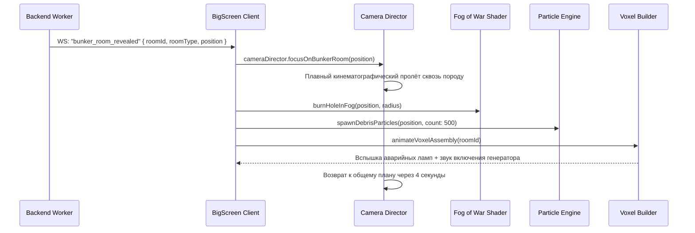

# BUNKER-disco — Frontend Architecture

> Версия: 1.2 | Дата: 2026-11-14 | Обновление: Tactile Card UI, 3D Voxel Engine, Camera Director, Fog of War, Масштабирование до 20 игроков

---

## Оглавление

1. [Структура проекта Vue.js](#1-структура-проекта-vuejs)
2. [Два режима: BigScreen и PlayerScreen](#2-два-режима-bigscreen-и-playerscreen)
3. [Воксельный движок Three.js и 3D-сцена](#3-воксельный-движок-threejs-и-3d-сцена)
   - 3.1. [Архитектура движка и рендерера](#31-архитектура-движка-и-рендерера)
   - 3.2. [Фаза 1 (Отбор): Поверхность и Туман Войны](#32-фаза-1-отбор-поверхность-и-туман-войны)
   - 3.3. [Механика открытия комнат бункера](#33-механика-открытия-комнат-бункера)
   - 3.4. [Фаза 2 (Выживание): Жизнь внутри бункера](#34-фаза-2-выживание-жизнь-внутри-бункера)
   - 3.5. [Режиссёрская камера (Camera Director)](#35-режиссёрская-камера-camera-director)
   - 3.6. [Масштабируемость и оптимизация до 20 игроков](#36-масштабируемость-и-оптимизация-до-20-игроков)
   - 3.7. [Воксельные персонажи и анимации](#37-воксельные-персонажи-и-анимации)
4. [Вайб физических карточек (Tactile Card UI & Animations)](#4-вайб-физических-карточек-tactile-card-ui--animations)
   - 4.1. [Дизайн-система TCG-карт](#41-дизайн-система-tcg-карт)
   - 4.2. [Раздача и эффектный 3D-переворот](#42-раздача-и-эффектный-3d-переворот)
   - 4.3. [Инспекция другого игрока (Интерактивное досье-веер)](#43-инспекция-другого-игрока-интерактивное-досье-веер)
   - 4.4. [Механика и UI перерандома персонажа](#44-механика-и-ui-перерандома-персонажа)
5. [Пиксельный RPG UI](#5-пиксельный-rpg-ui)
6. [Анимации и эффекты](#6-анимации-и-эффекты)
7. [State Management (Pinia)](#7-state-management-pinia)
8. [WebSocket клиент](#8-websocket-клиент)

---

## 1. Структура проекта Vue.js

### 1.1 Дерево файлов

```
bunker-disco-frontend/
├── public/
│   ├── fonts/                    # Пиксельные шрифты (Press Start 2P, Silkscreen)
│   ├── sounds/                   # SFX карточек, звуки затворов, фоновая музыка
│   └── models/voxels/            # Предрассчитанные воксельные меши комнат
│
├── src/
│   ├── main.ts                   # Entry point
│   ├── App.vue                   # Root компонент, селектор режимов (BigScreen / PlayerScreen)
│   │
│   ├── modes/
│   │   ├── BigScreen/            # TV / проектор режим
│   │   │   ├── BigScreenApp.vue
│   │   │   ├── scenes/
│   │   │   │   ├── BunkerScene.vue      # Контейнер Three.js воксельной сцены
│   │   │   │   ├── LobbyScene.vue       # Лобби на большом экране
│   │   │   │   ├── Phase1Scene.vue      # Поверхность + вход в бункер + Fog of War
│   │   │   │   └── Phase2Scene.vue      # Разрез бункера + комнаты с персонажами
│   │   │   └── overlays/
│   │   │       ├── VotingOverlay.vue    # Голосование поверх 3D сцены
│   │   │       ├── EventOverlay.vue     # Всплывающее событие
│   │   │       ├── ResourceBar.vue      # Панель ресурсов бункера
│   │   │       ├── SpeakerSpotlight.vue # Плашка активного оратора
│   │   │       ├── PlayerDossierModal.vue # Инспекция досье игрока на ТВ
│   │   │       └── DayCounter.vue       # Счётчик дня и таймер
│   │   │
│   │   └── PlayerScreen/         # Мобильный интерфейс игрока (телефон / ПК)
│   │       ├── PlayerApp.vue
│   │       ├── pages/
│   │       │   ├── JoinPage.vue         # Ввод 5-значного кода комнаты и никнейма
│   │       │   ├── LobbyPage.vue        # Ожидание игроков, выбор аватара, перерандом
│   │       │   ├── Phase1Page.vue       # Карточки, дебаты, голосование
│   │       │   └── Phase2Page.vue       # Назначение комнат, крафт, квесты
│   │       └── panels/
│   │           ├── MyCardsPanel.vue     # Тактильные карты с 3D гироскопом
│   │           ├── RerollControl.vue    # Кнопка перерандома со счётчиком
│   │           ├── PlayerDossierSheet.vue # Инспекция чужого досье снизу экрана
│   │           ├── AbilitiesPanel.vue   # Активные абилки с таймерами КД
│   │           ├── InventoryPanel.vue   # 3-4 слота, вес, крафт
│   │           ├── QuestsPanel.vue      # Скрытые цели
│   │           └── StatsPanel.vue       # Здоровье, Мораль, Энергия
│   │
│   ├── components/               # Общие переиспользуемые компоненты
│   │   ├── cards/                # Тактильная дизайн-система карт
│   │   │   ├── TactileCard.vue      # Базовый TCG контейнер с гиро-бликом и 3D флипом
│   │   │   ├── CardFoilOverlay.vue  # Голографический и фольгированный слой
│   │   │   ├── CardLockedBack.vue   # Бронированная рубашка с замком [LOCKED]
│   │   │   ├── CardLockBreaker.vue  # Анимация взлома замка при скане
│   │   │   ├── CardFanDeck.vue      # Веерное отображение карт досье
│   │   │   ├── ProfessionCard.vue
│   │   │   ├── HealthCard.vue
│   │   │   ├── BaggageCard.vue
│   │   │   └── SuperpowerCard.vue
│   │   │
│   │   ├── ui/                   # Пиксельный RPG UI Kit
│   │   │   ├── PixelButton.vue
│   │   │   ├── PixelProgressBar.vue
│   │   │   ├── PixelAvatar.vue
│   │   │   ├── PixelBadge.vue
│   │   │   ├── PixelToast.vue
│   │   │   └── PixelModal.vue
│   │   │
│   │   ├── voting/
│   │   │   ├── VoteTimer.vue
│   │   │   ├── VoteResults.vue
│   │   │   └── PlayerVoteButton.vue
│   │   │
│   │   └── bunker/
│   │       ├── RoomModule.vue
│   │       ├── ResourceGauge.vue
│   │       └── BunkerMap.vue
│   │
│   ├── engine/                   # Воксельный 3D движок на Three.js
│   │   ├── VoxelEngine.ts           # Базовая инициализация WebGL рендера
│   │   ├── SurfaceScene.ts          # Сцена поверхности (Фаза 1)
│   │   ├── BunkerBuilder.ts         # Генерация и рендеринг комнат бункера
│   │   ├── FogOfWarShader.ts        # Шейдер подземного тумана войны
│   │   ├── RoomRevealEffect.ts      # Партикловый эффект открытия комнаты
│   │   ├── CharacterFactory.ts      # Воксельный генератор аватаров (до 20 уникальных)
│   │   ├── CharacterCrowd.ts        # Менеджер толпы, поиск путей, избегание коллизий
│   │   ├── AnimationController.ts   # Анимации персонажей (idle, walk, talk, work, fight)
│   │   ├── CameraDirector.ts        # Интеллектуальный оператор камеры
│   │   └── VoxelAssets.ts           # Палитры и кэш вокселей
│   │
│   ├── stores/                   # Pinia stores
│   │   ├── index.ts
│   │   ├── roomStore.ts
│   │   ├── gameStore.ts
│   │   ├── playerStore.ts
│   │   ├── wsStore.ts
│   │   └── uiStore.ts
│   │
│   ├── composables/
│   │   ├── useCardGyroscope.ts      # Обработка гироскопа телефона для бликов
│   │   ├── useTactileAudio.ts       # Тактильные SFX переворота и щелчков
│   │   ├── useWebSocket.ts
│   │   ├── useVoxelEngine.ts
│   │   ├── useCameraDirector.ts
│   │   └── useVoting.ts
│   │
│   ├── api/                      # REST API клиент (Axios)
│   ├── router/                   # Vue Router
│   ├── styles/                   # CSS переменные, пиксельные стили, темы
│   └── utils/
│
├── vite.config.ts
├── tsconfig.json
└── package.json
```

---

## 2. Два режима: BigScreen и PlayerScreen

### 2.1 BigScreen (TV / Проектор)

- **Роль:** Главный экран трансляции для всей комнаты (Jackbox-style).
- **Разрешение:** 1920×1080 (Full HD) с динамическим масштабированием до 4K без потери пиксельной чёткости.
- **Интерактивность:** Полностью пассивный дисплей (no click-to-play). Управляется исключительно входящими WebSocket-событиями от сервера.
- **Главный элемент:** 3D-воксельная интерактивная диорама (поверхность земли + подземный бункер в разрезе), над которой парят пиксельные плашки статусов, ораторов и голосования.

### 2.2 PlayerScreen (Смартфон / Планшет / Ноутбук)

- **Роль:** Персональный пульт управления конкретного игрока.
- **Mobile-first UI:** Оптимизирован под вертикальную ориентацию экранов от 360px до 430px.
- **Тактильный фокус:** Игрок взаимодействует с виртуальной колодой карточек, как с настоящими физическими картами (слайды, перевороты, блики, тактильная вибрация).
- **Секретность:** Игрок видит свои скрытые карточки, личный инвентарь, тайные квесты и кнопки действий в реальном времени.

---

## 3. Воксельный движок Three.js и 3D-сцена

### 3.1 Архитектура движка и рендерера

Рендерер настроен на ретро-воксельный стиль:
- `antialias: false` и `setPixelRatio(1)` обеспечивают характерные резкие пиксельные грани без мыла.
- Инстансированный рендеринг (`THREE.InstancedMesh`) группирует воксели по цветам палитры, снижая количество вызовов отрисовки (draw calls) с сотен тысяч до менее 30 на кадр.
- Постобработка: мягкий bloom-эффект для неоновых элементов бункера и скайбокс с динамическим суточным циклом.

```typescript
// engine/VoxelEngine.ts
export class VoxelEngine {
  public scene: THREE.Scene;
  public camera: THREE.PerspectiveCamera;
  public renderer: THREE.WebGLRenderer;
  public cameraDirector: CameraDirector;
  public surfaceScene: SurfaceScene;
  public bunkerBuilder: BunkerBuilder;
  public characterCrowd: CharacterCrowd;

  constructor(canvas: HTMLCanvasElement) {
    this.renderer = new THREE.WebGLRenderer({
      canvas,
      antialias: false,
      powerPreference: 'high-performance',
      stencil: true
    });
    this.renderer.setPixelRatio(1);
    this.renderer.shadowMap.enabled = true;
    this.renderer.shadowMap.type = THREE.PCFSoftShadowMap;

    this.scene = new THREE.Scene();
    this.scene.background = new THREE.Color(0x0f111a);

    this.camera = new THREE.PerspectiveCamera(40, 16 / 9, 0.5, 1000);
    this.cameraDirector = new CameraDirector(this.camera);

    this.surfaceScene = new SurfaceScene(this.scene);
    this.bunkerBuilder = new BunkerBuilder(this.scene);
    this.characterCrowd = new CharacterCrowd(this.scene);

    this.initLighting();
  }

  private initLighting() {
    // Верхнее холодное постапокалиптическое солнце
    const sunLight = new THREE.DirectionalLight(0xdde8ff, 1.2);
    sunLight.position.set(40, 60, 30);
    sunLight.castShadow = true;
    sunLight.shadow.mapSize.width = 2048;
    sunLight.shadow.mapSize.height = 2048;
    this.scene.add(sunLight);

    // Рассеянное фоновое освещение
    const ambientLight = new THREE.AmbientLight(0x2a2b3d, 0.6);
    this.scene.add(ambientLight);
  }
}
```

---

### 3.2 Фаза 1 (Отбор): Поверхность и Туман Войны

В Фазе 1 фокус камеры находится на поверхности земли перед массивным входом в бункер.

```
+-------------------------------------------------------------------------+
| [ПОВЕРХНОСТЬ ЗЕМЛИ] Небо, сухие воксельные деревья, костёр, бочки, палатки |
|      (o_o)       (^_^)      [HERMETIC DOOR]     (o_o)       (-_-)       |
|    Персонаж 1  Персонаж 2       [ЗАКРЫТО]     Персонаж 3  Персонаж 4    |
| ============================= УРОВЕНЬ ГРУНТА ========================== |
|  ░░░░░░░░░░░░░░░░░░░░░░░░░░░░░░░░░░░░░░░░░░░░░░░░░░░░░░░░░░░░░░░░░░░░░░ |
|  ░░░░░░░░░░░░░░ ТУМАН ВОЙНЫ (FOG OF WAR / ПОДЗЕМНЫЙ СРЕЗ) ░░░░░░░░░░░░░░░ |
|  ░░░░░░░░░░░░░░░░░░░░░░░░░░░░░░░░░░░░░░░░░░░░░░░░░░░░░░░░░░░░░░░░░░░░░░ |
+-------------------------------------------------------------------------+
```

#### Визуальные элементы поверхности:
1. **Постапокалиптический лес и холмы:** Воксельные скалы, чахлые деревья с опадающей листвой, ржавые автомобильные остовы, временный палаточный лагерь и костёр с частицами тлеющих углей.
2. **Вход в бункер:** Колоссальная бронированная гермодверь с гидравлическими засовами и предупреждающими жёлто-чёрными полосами. Дверь запечатана.
3. **Поведение персонажей снаружи:**
   - До 20 воксельных персонажей перемещаются по площадке перед входом.
   - Во время своего выступления персонаж выходит к костру или трибуне, жестикулирует руками (talk animation), над его головой всплывает индикатор оратора и открытые карты.
   - Остальные игроки собираются полукругом, слушают, перешёптываются или ходят вокруг в режиме ожидания (idle wander).

#### Реализация Тумана Войны (Fog of War):
Подземный срез бункера уже сгенерирован в памяти, но визуально заблокирован кастомным шейдером и воксельной теневой завесой:
- **Объёмный теневой объём:** Сетка из тёмно-серых/чёрных полупрозрачных вокселей с шумом Перлина (Simplex Noise), имитирующая неисследованную толщу земли.
- **Shader Mask:** Пиксельный шейдер отсекает внутреннее освещение неисследованных комнат, делая их абсолютно чёрными с лёгким синим контуром сканирования (радарный эффект).

```glsl
// engine/shaders/fogOfWar.frag
uniform sampler2D uRoomMask;
uniform float uTime;
varying vec3 vWorldPosition;

void main() {
    vec2 uv = vWorldPosition.xz * 0.05;
    float noise = sin(uv.x * 10.0 + uTime) * cos(uv.y * 10.0 + uTime);
    float isRevealed = texture2D(uRoomMask, vWorldPosition.xz).r;

    if (isRevealed < 0.5) {
        // Комната скрыта туманом
        vec3 fogColor = vec3(0.05, 0.06, 0.1) + vec3(noise * 0.02);
        gl_FragColor = vec4(fogColor, 0.95);
    } else {
        discard; // Полная видимость открытого помещения
    }
}
```

---

### 3.3 Механика открытия комнат бункера

Когда ведущий или игрок открывает карточку бункера (или исследуется новый отсек), происходит зрелищная процедура демаскирования:



1. **Рассеивание тумана:** В маске тумана войны прожигается динамическое отверстие с эффектом рассыпающихся пикселей.
2. **Воксельная сборка:** Стены, оборудование (койки, верстаки, серверные стойки) проявляются с вертикальной анимацией падения вокселей сверху вниз с мягким отскоком (bounce easing).
3. **Освещение:** Внутри комнаты включается тусклый аварийный свет (красный или зелёный), затем с гудением трансформатора зажигаются дневные лампы.
4. **Реакция толпы:** Персонажи на поверхности реагируют эмодзи-бабблами над головами (удивление, одобрение, паника).

---

### 3.4 Фаза 2 (Выживание): Жизнь внутри бункера

С наступлением Фазы 2 игра полностью переключается на подземный изометрический срез.

#### 1. Запечатывание гермодвери (Инициация):
- Камера фиксирует драматичный момент: выжившие забегают внутрь шлюза.
- Изгнанные персонажи остаются снаружи у угасающего костра в тумане.
- Колоссальная дверь со скрежетом опускается, из уплотнителей вырываются струи пара (воксельные спрайты дыма), загораются красные стробоскопы «LOCKDOWN».
- Камера опускается под землю, разворачиваясь в фронтально-изометрический срез всех открытых этажей бункера.

#### 2. Интерактивная жизнь персонажей:
Персонажи внутри бункера не стоят на месте, а ведут активную симуляцию выживания:
- **Назначение на работу:** Если игрок отправлен на кухню — его воксельный аватар подходит к разделочному столу и начинает готовить; если в медпункт — укладывает раненых или смешивает лекарства; в мастерскую — стучит молотком у верстака.
- **Отдых:** При низком уровне энергии персонажи идут в жилой блок и ложатся на воксельные двухъярусные кровати (анимация Zzz).
- **Ликвидация ЧП:**
  - При утечке воды персонажи бегут с гаечными ключами перекрывать трубы.
  - При пожаре хватают огнетушители и распыляют белые воксели пены.
  - При токсичной утечке надевают противогазы или кашляют, теряя HP.

---

### 3.5 Режиссёрская камера (Camera Director)

`CameraDirector` — отдельный автономный модуль, обеспечивающий телевизионный продакшн без участия человека. Он анализирует текущие игровые события и плавно управляет положением, вращением камеры и углом обзора (FOV).

```typescript
// engine/CameraDirector.ts
export class CameraDirector {
  private camera: THREE.PerspectiveCamera;
  private currentMode: 'SURFACE_WIDE' | 'SPEAKER_FOCUS' | 'VOTE_ARENA' | 'BUNKER_OVERVIEW' | 'EMERGENCY_TRACK' = 'SURFACE_WIDE';
  private targetPosition = new THREE.Vector3();
  private targetLookAt = new THREE.Vector3();

  constructor(camera: THREE.PerspectiveCamera) {
    this.camera = camera;
  }

  // Общий план поверхности (Фаза 1 дебаты)
  public toSurfaceWide() {
    this.currentMode = 'SURFACE_WIDE';
    this.smoothTransition(new THREE.Vector3(0, 18, 32), new THREE.Vector3(0, 3, 0), 2.0);
  }

  // Фокус на говорящем игроке (Speech / Card Reveal)
  public focusOnSpeaker(characterPosition: THREE.Vector3) {
    this.currentMode = 'SPEAKER_FOCUS';
    const cameraOffset = new THREE.Vector3(
      characterPosition.x + 4,
      characterPosition.y + 3,
      characterPosition.z + 8
    );
    this.smoothTransition(cameraOffset, characterPosition, 1.2, 32); // узкий FOV для кинематографичности
  }

  // Драматический общий план при голосовании за изгнание
  public toVotingArena() {
    this.currentMode = 'VOTE_ARENA';
    this.smoothTransition(new THREE.Vector3(0, 25, 20), new THREE.Vector3(0, 0, 0), 1.5, 45);
  }

  // Полный изометрический разрез бункера (Фаза 2)
  public toBunkerOverview(bunkerCenter: THREE.Vector3, depth: number) {
    this.currentMode = 'BUNKER_OVERVIEW';
    this.smoothTransition(
      new THREE.Vector3(bunkerCenter.x + 35, bunkerCenter.y + 15, bunkerCenter.z + 45),
      new THREE.Vector3(bunkerCenter.x, -depth / 2, bunkerCenter.z),
      2.5,
      40
    );
  }

  // Тряска камеры при авариях и катастрофах
  public triggerShake(intensity = 0.8, durationMs = 800) {
    const startTime = performance.now();
    const originalPos = this.camera.position.clone();

    const shakeInterval = setInterval(() => {
      const elapsed = performance.now() - startTime;
      if (elapsed >= durationMs) {
        clearInterval(shakeInterval);
        this.camera.position.copy(originalPos);
        return;
      }
      const damping = 1 - (elapsed / durationMs);
      this.camera.position.x = originalPos.x + (Math.random() - 0.5) * intensity * damping;
      this.camera.position.y = originalPos.y + (Math.random() - 0.5) * intensity * damping;
    }, 16);
  }

  private smoothTransition(pos: THREE.Vector3, lookAt: THREE.Vector3, durationSec: number, fov = 40) {
    new TWEEN.Tween(this.camera.position)
      .to({ x: pos.x, y: pos.y, z: pos.z }, durationSec * 1000)
      .easing(TWEEN.Easing.Cubic.Out)
      .start();

    new TWEEN.Tween(this.targetLookAt)
      .to({ x: lookAt.x, y: lookAt.y, z: lookAt.z }, durationSec * 1000)
      .easing(TWEEN.Easing.Cubic.Out)
      .onUpdate(() => this.camera.lookAt(this.targetLookAt))
      .start();

    new TWEEN.Tween(this.camera)
      .to({ fov }, durationSec * 1000)
      .easing(TWEEN.Easing.Cubic.Out)
      .onUpdate(() => this.camera.updateProjectionMatrix())
      .start();
  }
}
```

---

### 3.6 Масштабируемость и оптимизация до 20 игроков

BUNKER-disco рассчитан на масштабные сессии до 20 участников. Чтобы сцена не превратилась в хаос, а FPS стабильно держался на отметке 60 кадров/сек:

1. **Крауд-менеджмент (CharacterCrowd & Slots):**
   - Вокруг костра и перед бункером размечена сетка из 24 слотов с заданными направлениями взгляда.
   - Персонажи используют алгоритм steering behaviors (поиск пути с отталкиванием соседей). Они никогда не застревают друг в друге.
   - Если число игроков > 12, слоты автоматически выстраиваются в два полукруглых амфитеатра с разной высотой грунта, чтобы задние ряды не перекрывали передних.

2. **Billboard UI над головами:**
   - Каждому персонажу сопутствует легковесный 2D-спрайт с именем игрока и бейджами профессий.
   - Спрайты динамически масштабируются в зависимости от расстояния до камеры (`matrixAutoUpdate = false`, расчёт только при движении).
   - При отдалении камеры мелкие детали скрываются, остаётся только цветовой индикатор и никнейм.

3. **Лимиты рендеринга и геометрии:**
   - 20 воксельных персонажей × 25 вокселей = 500 вокселей на персонажей.
   - Стены комнат бункера используют greedy-meshing: соседние воксели одной текстуры объединяются в единые прямоугольные полигоны, что снижает общее число треугольников на 75%.

---

### 3.7 Воксельные персонажи и анимации

Каждый персонаж генерируется процедурно на основе сида (`avatarSeed`), профессии, пола и карточек здоровья:

```
      [ ШЛЯПА / КАСКА ]        <- Аксессуар профессии (жёлтая каска инженера, колпак повара)
        [ГОЛОВА 2x2x2]         <- Оттенок кожи, цвет волос, пиксельные глаза
        [ТЕЛО  2x3x2]          <- Одежда (халат врача, камуфляж военного, костюм)
      [РУКА]     [РУКА]        <- Анимированные блоки (могут держать предметы)
      [НОГА]     [НОГА]        <- Шагающая циклограмма walk cycle
```

#### Набор процедурных анимаций:
- `idle`: Легкое дыхание (движение головы и плеч по синусоиде вверх-вниз на 1 пиксель).
- `walk`: Качание рук и поочередный наклон ног с амплитудой 25°.
- `talk`: Поворот корпуса к аудитории, активная жестикуляция одной или двумя руками.
- `shock / panic`: Подпрыгивание на месте с вытянутыми вверх руками.
- `work`: Наклон над оборудованием с цикличными движениями инструмента.
- `die`: Падение назад с рассыпанием на несколько цветных вокселей.

---

## 4. Вайб физических карточек (Tactile Card UI & Animations)

В BUNKER-disco ключевой интерфейсный приоритет — **ощущение физической настольной игры**. Карточки на экране смартфона и ТВ ведут себя как дорогие коллекционные TCG-карты из плотного ламинированного пластика с фольгированием и тактильным откликом.

```
       ┌───────────────────────────────┐
       │ 🛡️ ВОЕННЫЙ БУНКЕР 007         │ <- Тиснёный логотип бункера
       ├───────────────────────────────┤
       │ ┌───────────────────────────┐ │
       │ │   [ ПИКСЕЛЬНЫЙ АРТ ]      │ │ <- Голографический фольгированный слой
       │ │                           │ │    (радужный градиент при наклоне)
       │ └───────────────────────────┘ │
       │ 🏷️ ПРОФЕССИЯ: ВОЕННЫЙ ХИРУРГ │ <- Категория и золотая рамка
       │                               │
       │  "Шью без наркоза, пока       │ <- Наклонный ролевой флейвор
       │   падают бомбы"               │
       │                               │
       │ ⚙️ ПАССИВ: +20% к медикаментам│
       │ ⚡ АБИЛКА: Полевая ампутация  │
       │    [ КД: 2 раунда ]           │
       │                               │
       │ ░░░░░░░░░░░░░░░░░░░░░░ [BASE] │ <- Пиксельный микрошрифт и тиснёная печать
       └───────────────────────────────┘
```

### 4.1 Дизайн-система TCG-карт

Каждая карточка на фронтенде собирается из многослойного шейдерного пирога:

1. **Текстура основы (Plastic Matte & Scratches):** Микропиксельный шум потёртого ламината со сколами по краям и штампованными номерами партии («BUNKER-CORP #048/2026»).
2. **Фольгированные рамки по редкости:**
   - `[BASE]` — потёртая стальная рамка со следами заклёпок.
   - `[NEW] / [RARE]` — мерцающее неоново-голубое свечение.
   - `[ALPHA] / [EPIC]` — фиолетовое гальваническое покрытие.
   - `[LEGENDARY]` — золотое тиснение с радужным перламутровым отливом.
3. **Динамический блик (Гироскоп & Мышь):**
   При наклоне телефона игроком (событие `DeviceOrientationEvent`) или движении курсора на ПК по поверхности карты скользит интерактивный световой блик и спектральный радужный градиент:

```css
/* styles/tactile-card.css */
.tactile-card {
  perspective: 1000px;
  transform-style: preserve-3d;
  transition: transform 0.1s ease-out;
  border-radius: 0; /* строго пиксельные углы */
  image-rendering: pixelated;
  box-shadow: 6px 6px 0px rgba(0, 0, 0, 0.85);
}

.tactile-card__foil {
  background: linear-gradient(
    calc(var(--gyro-tilt-x, 0deg) + 115deg),
    transparent 20%,
    rgba(255, 255, 255, 0.25) 45%,
    rgba(255, 215, 0, 0.4) 50%,
    rgba(147, 51, 234, 0.3) 55%,
    transparent 80%
  );
  mix-blend-mode: color-dodge;
  pointer-events: none;
}
```

```typescript
// composables/useCardGyroscope.ts
export function useCardGyroscope(cardElementRef: Ref<HTMLElement | null>) {
  const onOrientation = (e: DeviceOrientationEvent) => {
    if (!cardElementRef.value || e.gamma === null || e.beta === null) return;
    const tiltX = Math.min(Math.max(e.gamma, -30), 30); // ограничение до 30 градусов
    const tiltY = Math.min(Math.max(e.beta - 45, -30), 30);
    cardElementRef.value.style.setProperty('--gyro-tilt-x', `${tiltX * 2}deg`);
    cardElementRef.value.style.transform = `rotateY(${tiltX * 0.4}deg) rotateX(${-tiltY * 0.4}deg)`;
  };

  onMounted(() => window.addEventListener('deviceorientation', onOrientation));
  onUnmounted(() => window.removeEventListener('deviceorientation', onOrientation));
}
```

---

### 4.2 Раздача и эффектный 3D-переворот

1. **Сценическая раздача рубашкой вверх:**
   В начале раунда все 7 карт вылетают на стол игрока из виртуальной колоды со звуком быстрого скользящего шелеста (`card_deal_whoosh.mp3`). Карты ложатся плотной стопкой или веером, скрытые рубашкой.
2. **Тактильный 3D Flip по тапу:**
   - При клике на карточку игрок словно «поддевает» её ногтем.
   - Карта плавно приподнимается над столом (увеличивается тень `box-shadow: 12px 12px 0 #000`, `scale(1.05)`).
   - Затем совершает сочный переворот на 180° вдоль оси Y (`rotateY(180deg)`) с физическим аудио-эффектом (`card_flip_heavy_click.mp3`) и виброоткликом телефона (`navigator.vibrate(35)`).
   - В момент достижения 90° рубашка сменяется лицевой стороной с яркой золотой вспышкой по контуру.

---

### 4.3 Инспекция другого игрока (Интерактивное досье-веер)

На TV (кликом хоста) или на телефоне любого игрока можно нажать на имя/аватар любого соперника, чтобы раскрыть его **Интерактивное досье выживальщика**:

```
        ┌─────────────── [ДОСЬЕ: АЛЕКСЕЙ (ИГРОК 4)] ───────────────┐
        │                                                          │
        │   ┌────────┐   ┌────────┐   ┌────────┐   ┌────────┐      │
        │   │ПРОФЕС. │   │БИОЛОГ. │   │ЗДОРОВЬЕ│   │ ХОББИ  │      │
        │   │ ХИМИК  │   │32 ГОДА │   │🔒LOCKED│   │🔒LOCKED│ ...  │
        │   │ (ОТКР) │   │ (ОТКР) │   │  [?]   │   │  [?]   │      │
        │   └────────┘   └────────┘   └────────┘   └────────┘      │
        │                                                          │
        │ Статус: Жив | Голосов против: 2 | Место в бункере: ❓    │
        └──────────────────────────────────────────────────────────┘
```

1. **Раскладка веером (Card Fan Deck):** Карточки персонажа выкладываются в удобный для чтения полукруглый веер.
2. **Открытые карты:** Отображаются в полную величину со всеми свойствами, пассивами и открытыми слабостями.
3. **Закрытые карты (Бронированная рубашка):** Оформлены как стальная сейфовая пластина бункера с массивным пиксельным замком и плашкой `[LOCKED]`. Текст скрыт.
4. **Анимация взлома при способностях:**
   Если другой игрок применяет способность разведки (например, «Скан Врача», «Взлом Хакера» или «Обыск СБшника»):
   - Замок закрытой карты начинает дрожать, раскаляется докрасна и взрывается пиксельными искрами (`lock_shatter.mp3`).
   - Рубашка переворачивается, карта раскрывается для подглядывающего или для всего зала.

---

### 4.4 Механика и UI перерандома персонажа

В лобби или перед стартом раунда (в зависимости от настроек хоста `allowReroll: true`) игроку доступна опция перерандома своего набора карт.

```
       ┌──────────────────────────────────────────────────────────┐
       │ 🎲 ПЕРЕРАНДОМИТЬ ПЕРСОНАЖА                               │
       │ [Осталось попыток: 2 из 2]                               │
       │                                                          │
       │  Нажмите, чтобы сбросить все текущие карточки и          │
       │  получить случайный новый набор из колод бункера.        │
       │                                                          │
       │ ┌──────────────────────────────────────────────────────┐ │
       │ │  [ 🔄 СГЕНЕРИРОВАТЬ НОВОГО ПЕРСОНАЖА (2 ЛИМИТ) ]    │ │
       │ └──────────────────────────────────────────────────────┘ │
       └──────────────────────────────────────────────────────────┘
```

#### Визуальная анимация перерандома:
1. Игрок нажимает большую рельефную пиксельную кнопку `[ 🔄 СГЕНЕРИРОВАТЬ НОВОГО ПЕРСОНАЖА ]`.
2. Счётчик уменьшается: `Осталось попыток: 1 из 2`. Кнопка блокируется на 2 секунды.
3. Звучит звук сминаемой бумаги и сброса колоды в шредер (`cards_sweep_discard.mp3`).
4. Все 7 текущих карт со стола с ускорением улетают в правый нижний угол за пределы экрана.
5. Из центра экрана с эффектом слот-машины вылетают новые карты, переворачиваясь рубашкой вверх.
6. Экран вибрирует приятным двойным импульсом `navigator.vibrate([40, 60, 40])`.

---

## 5. Пиксельный RPG UI

### 5.1 Принципы дизайна
- Все экранные рамки, кнопки и панели выровнены по 4px / 8px сетке.
- Запрещены CSS-скругления (`border-radius: 0`).
- Пиксельные тени без размытия: `box-shadow: 4px 4px 0 #000`.
- Встроенные шрифты: `Press Start 2P` для заголовков и важных цифр, `Silkscreen` для описаний и списков.

### 5.2 Цветовая палитра темы

```css
:root {
  --bg-dark:        #0d0d1a;
  --bg-panel:       #16162a;
  --bg-card:        #1b1c36;
  --bg-hover:       #24264a;

  --border-primary: #3f416d;
  --border-gold:    #ffc700;
  --border-danger:  #e02424;
  --border-success: #059669;

  --text-main:      #f3f4f6;
  --text-muted:     #9ca3af;
  --text-gold:      #fcd34d;

  /* Индикаторы ресурсов */
  --res-food:       #84cc16;
  --res-water:      #06b6d4;
  --res-air:        #e0f2fe;
  --res-med:        #f43f5e;
  --res-morale:     #fbbf24;
  --res-power:      #f97316;
}
```

---

## 6. Анимации и эффекты

### 6.1 Анимация голосования (BigScreen Voting Overlay)
1. Камера переключается в режим `VOTE_ARENA`.
2. Экран слегка затемняется полупрозрачной пиксельной сеткой (dither pattern).
3. В центре крупно появляется воксельный бюст обвиняемого с мерцающей красной рамкой.
4. По бокам экрана зажигаются лампы статуса готовности каждого из игроков.
5. При вскрытии результатов голоса «За» и «Против» материализуются со звуком падающих печатей.

### 6.2 Анимация изгнания (Elimination Sequence)
1. Свет прожекторов бункера фокусируется на изгнаннике.
2. Персонаж опускает голову, медленно разворачивается и уходит в темноту пустоши.
3. Его личная карточка на экране сгорает пиксельным шейдером растворения (dissolve effect).
4. Ворота бункера захлопываются на один запор громче.

---

## 7. State Management (Pinia)

Клиентское состояние строго разделено между 5 специализированными хранилищами Pinia:

| Стор | Назначение |
|------|-----------|
| `useRoomStore` | Код комнаты, список игроков, пинги, хост-статус, настройки правил, лимит перерандомов |
| `useGameStore` | Текущая фаза (Lobby/Phase1/Phase2/Ended), состояние голосования, день, ресурсы |
| `usePlayerStore` | Личные карточки (рука), здоровье, мораль, инвентарь, квесты, оставшиеся перерандомы |
| `useWsStore` | Статус WebSocket сокета, очередь исходящих событий, пинг |
| `useUiStore` | Модальные окна, досье игроков, тосты, оверлеи голосования, аудио-микшер SFX |

---

## 8. WebSocket клиент

Связь с сервером базируется на отказоустойчивом WebSocket соединении (Socket.io-client):
- **Автоматический реконнект:** Экспоненциальный откат (1с, 2с, 5с, максимум 10с).
- **Синхронизация состояния:** При повторном подключении клиент отправляет запрос `request_full_state`, полностью восстанавливая локальный стор Pinia без перезагрузки веб-страницы.
- **Heartbeat:** Пинг каждые 10 секунд с замером пинга для отображения стабильности соединения у каждого игрока.
