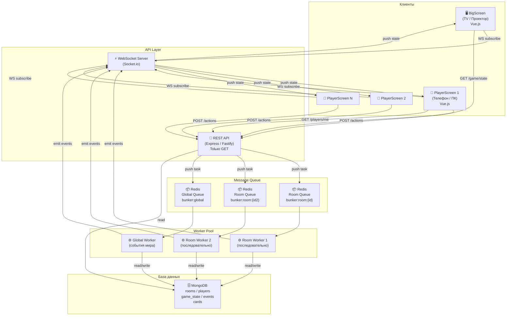
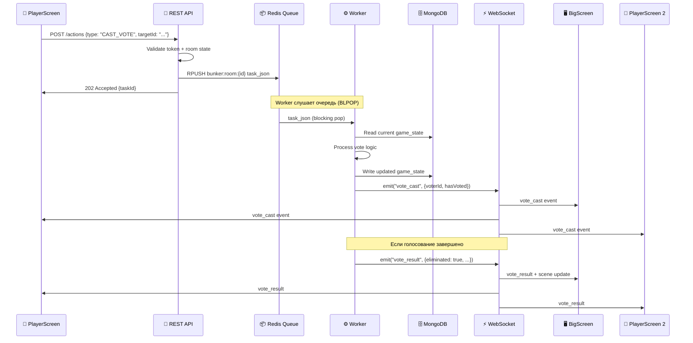

# BUNKER-disco — Общая архитектура системы

> Версия документа: 1.0 | Дата: 2026-11-14

---

## Оглавление

1. [Диаграмма системы](#1-диаграмма-системы)
2. [Компоненты и их роли](#2-компоненты-и-их-роли)
3. [Worker: принцип работы](#3-worker-принцип-работы)
4. [Redis: организация очередей](#4-redis-организация-очередей)
5. [MongoDB: схема коллекций](#5-mongodb-схема-коллекций)
6. [WebSocket-события](#6-websocket-события)
7. [Поток данных](#7-поток-данных)

---

## 1. Диаграмма системы



---

## 2. Компоненты и их роли

### 2.1 Клиенты

| Клиент | Описание |
|--------|----------|
| **BigScreen (TV/Проектор)** | Общий экран для всех игроков. Отображает воксельную сцену бункера, текущую фазу игры, карточки, голосование, события. Только **читает** состояние через WS и REST GET. |
| **PlayerScreen (Телефон/ПК)** | Личный интерфейс каждого игрока. Показывает карточки персонажа, доступные действия, результаты голосования. **Отправляет действия** на сервер через POST /actions. |

Оба типа клиентов реализованы на **Vue.js** с воксельным 3D-движком (Three.js) для BigScreen и пиксельным RPG-интерфейсом.

---

### 2.2 REST API

**Роль:** Единственная точка входа для клиентов.

- **Только GET-эндпоинты** для чтения состояния игры из MongoDB
- **POST /actions** — единственный мутирующий эндпоинт; не изменяет данные напрямую, а кладёт задачу в Redis Queue
- Аутентификация: `room_code` + `player_token` (JWT)
- Stateless: не хранит состояние между запросами

```
GET  /rooms/:id/state       → читает из MongoDB
POST /actions               → пишет задачу в Redis
```

---

### 2.3 WebSocket Server (Socket.io)

**Роль:** Real-time синхронизация всех клиентов.

- Каждая комната — отдельный **namespace** или **room** в Socket.io
- Клиенты подписываются при входе в игру
- Worker эмитит события после обработки задач
- BigScreen и все PlayerScreen получают обновления одновременно

---

### 2.4 Redis

**Роль:** Брокер задач между API и Worker.

- Одна очередь на комнату (`bunker:room:{roomId}`) — гарантия последовательности
- Одна глобальная очередь (`bunker:global`) — системные события
- Задачи хранятся в виде JSON-объектов
- TTL на задачи: 24 часа (защита от утечек)

---

### 2.5 Worker

**Роль:** Единственное место, где происходят мутации состояния игры.

- Запускается как отдельный процесс (или кластер процессов)
- Слушает Redis-очереди с помощью `BLPOP` (blocking pop)
- Для каждой комнаты — **один поток обработки** (последовательно)
- Разные комнаты обрабатываются **параллельно** в отдельных воркерах
- После обработки задачи — пишет в MongoDB и эмитит WS-события

---

### 2.6 MongoDB

**Роль:** Единственный источник истины (source of truth).

- Хранит всё состояние игры, карточки, игроков, события
- API читает из MongoDB для ответа на GET-запросы
- Worker пишет в MongoDB после обработки задач

---

## 3. Worker: принцип работы

### 3.1 Последовательность внутри комнаты

Каждая комната имеет **одну дедикированную очередь** в Redis. Worker, обслуживающий эту очередь, обрабатывает задачи **строго одну за другой**:

```
Room Queue: [Task_A] → [Task_B] → [Task_C]
                ↓
         Worker берёт Task_A
         Обрабатывает (read → compute → write → emit)
         Завершает
                ↓
         Worker берёт Task_B
         ...
```

**Почему строгая последовательность внутри комнаты?**

- Игровое состояние — детерминированная конечная машина состояний
- Два одновременных голосования или действия дали бы race condition
- Порядок действий влияет на исход: «изгнать игрока» должно завершиться до того, как «игрок использует способность»
- Упрощает логику: не нужны блокировки на уровне БД

### 3.2 Параллелизм между комнатами

Разные комнаты — независимые игры. Их задачи обрабатываются **параллельно**:

```
Room A Queue → Worker A (process A1, A2, A3...)
Room B Queue → Worker B (process B1, B2, B3...)  ← одновременно
Room C Queue → Worker C (process C1, C2, C3...)  ← одновременно
```

**Реализация:**

```javascript
// Упрощённая схема
const rooms = await getActiveRooms(); // ['room_A', 'room_B', 'room_C']

// Запускаем воркер на каждую комнату
rooms.forEach(roomId => {
  startRoomWorker(roomId); // каждый воркер - отдельная асинхронная цепочка
});

async function startRoomWorker(roomId) {
  while (true) {
    const task = await redis.blpop(`bunker:room:${roomId}`, 0); // blocking
    await processTask(task); // строго последовательно
  }
}
```

---

## 4. Redis: организация очередей

### 4.1 Структура очередей

```
Redis Keys:
  bunker:global              — глобальные системные события
  bunker:room:{roomId}       — очередь комнаты (List)
  bunker:room:{roomId}:meta  — метаданные обработки (Hash)
  bunker:lock:{roomId}       — мьютекс (если нужен distributed lock)
  bunker:ttl:{taskId}        — TTL задачи
```

### 4.2 Формат задачи в очереди

```json
{
  "taskId": "uuid-v4",
  "type": "GameAction",
  "roomId": "ROOM_CODE",
  "playerId": "player_mongo_id",
  "payload": {
    "action": "CAST_VOTE",
    "targetPlayerId": "...",
    "round": 3
  },
  "createdAt": "2026-11-14T10:00:00Z",
  "retryCount": 0,
  "maxRetries": 3
}
```

### 4.3 Жизненный цикл задачи в Redis

```
API → RPUSH bunker:room:{id} task_json
              ↓
Worker → BLPOP bunker:room:{id}
              ↓
Worker обрабатывает задачу
              ↓
  Успех → пишет в MongoDB + emit WS
  Ошибка → RPUSH обратно (если retryCount < maxRetries)
              ↓
  Исчерпаны retries → RPUSH bunker:dead_letter task_json + alert
```

### 4.4 Глобальная очередь

Используется для событий, не привязанных к конкретной комнате:

- Системные уведомления (server maintenance)
- Истечение срока жизни неактивных комнат
- Аналитика и логирование
- Плановые события (ежедневный сброс)

---

## 5. MongoDB: схема коллекций

### 5.1 `rooms`

```javascript
{
  _id: ObjectId,
  code: String,          // "ABCD1" — 5-значный код для входа
  hostId: ObjectId,      // ссылка на players._id
  status: String,        // "lobby" | "phase1" | "phase2" | "ended"
  settings: {
    maxPlayers: Number,  // 4–12
    bunkerCapacity: Number, // сколько игроков войдёт в бункер
    phase2Days: Number,  // 30 по умолчанию
    revealMode: String,  // "sequential" | "simultaneous"
    language: String,    // "ru" | "en"
  },
  createdAt: Date,
  updatedAt: Date,
  expiresAt: Date,       // TTL-индекс: авто-удаление через 24ч после окончания
}
```

### 5.2 `players`

```javascript
{
  _id: ObjectId,
  roomId: ObjectId,       // ссылка на rooms._id
  socketId: String,       // текущий socket.io id
  token: String,          // JWT для аутентификации
  nickname: String,
  avatarSeed: String,     // seed для генерации воксельного аватара
  isHost: Boolean,
  isConnected: Boolean,
  isEliminated: Boolean,  // изгнан в фазе 1
  isInBunker: Boolean,    // прошёл в бункер
  
  // Карточки персонажа (Фаза 1)
  cards: {
    profession: { cardId: ObjectId, isRevealed: Boolean },
    biology: { cardId: ObjectId, isRevealed: Boolean },
    health: { cardId: ObjectId, isRevealed: Boolean },
    phobia: { cardId: ObjectId, isRevealed: Boolean },
    hobby: { cardId: ObjectId, isRevealed: Boolean },
    baggage: { cardId: ObjectId, isRevealed: Boolean },
    fact: { cardId: ObjectId, isRevealed: Boolean },
    specialAbility: { cardId: ObjectId, isRevealed: Boolean },
  },
  
  // Статы (Фаза 2)
  stats: {
    health: Number,       // 0–100
    morale: Number,       // 0–100
    energy: Number,       // 0–100
  },
  
  // Инвентарь (Фаза 2)
  inventory: [{ itemId: ObjectId, quantity: Number }],
  
  // Способности
  abilities: [{
    abilityId: String,
    cooldownRemaining: Number,
    usesRemaining: Number,
  }],
  
  joinedAt: Date,
  lastActiveAt: Date,
}
```

### 5.3 `game_state`

```javascript
{
  _id: ObjectId,
  roomId: ObjectId,         // 1:1 с rooms
  
  phase: String,            // "lobby" | "phase1" | "phase2" | "ended"
  
  // Фаза 1: Отбор
  phase1: {
    currentRound: Number,
    currentPlayerTurnId: ObjectId, // чья очередь открывать карточки
    revealOrder: [ObjectId],       // порядок игроков
    votingState: {
      isActive: Boolean,
      nomineeId: ObjectId,
      votes: [{ voterId: ObjectId, vote: Boolean }],
      endsAt: Date,
    },
    eliminatedPlayers: [ObjectId],
    roundsCompleted: Number,
  },
  
  // Фаза 2: Выживание
  phase2: {
    currentDay: Number,     // 1–30
    currentTick: Number,    // шаги внутри дня
    
    // Ресурсы бункера
    resources: {
      food: Number,
      water: Number,
      air: Number,
      medicine: Number,
      morale: Number,
      power: Number,
    },
    
    // Комнаты бункера
    rooms: [{
      roomType: String,     // "medical" | "food_storage" | "workshop" | ...
      level: Number,
      isOperational: Boolean,
      assignedPlayers: [ObjectId],
    }],
    
    // Активные события
    activeEvents: [{ eventId: ObjectId, turnsRemaining: Number }],
    
    // Лог
    dayLog: [{ day: Number, summary: String, events: [ObjectId] }],
  },
  
  // История действий
  actionLog: [{
    actionType: String,
    playerId: ObjectId,
    payload: Object,
    timestamp: Date,
    result: Object,
  }],
  
  updatedAt: Date,
}
```

### 5.4 `events`

```javascript
{
  _id: ObjectId,
  
  // Шаблон события (статичные данные)
  template: {
    eventId: String,          // "FOOD_SHORTAGE", "TOXIC_GAS_LEAK", ...
    name: String,
    description: String,
    phase: String,            // "phase1" | "phase2" | "both"
    category: String,         // "resource" | "threat" | "social" | "discovery"
    rarity: String,           // "common" | "rare" | "legendary"
    
    effects: [{
      target: String,         // "food" | "morale" | "player" | "room"
      type: String,           // "delta" | "set" | "debuff"
      value: Number,
    }],
    
    choices: [{               // варианты ответа на событие
      choiceId: String,
      text: String,
      requirements: Object,   // проверка способностей/карточек
      consequences: Object,
    }],
    
    duration: Number,         // дней (0 = мгновенное)
  },
  
  // Инстанс события в игре
  instance: {
    roomId: ObjectId,
    triggeredAt: Date,
    triggeredOnDay: Number,
    resolvedAt: Date,
    chosenOptionId: String,
    affectedPlayerIds: [ObjectId],
  },
}
```

### 5.5 `cards`

```javascript
{
  _id: ObjectId,
  cardId: String,            // уникальный строковый ID: "prof_doctor"
  type: String,              // "profession" | "biology" | "health" | "phobia" | "hobby" | "baggage" | "fact" | "ability"
  tags: [String],            // ["BASE"] или ["NEW"] или ["RARE", "NEW"]
  
  // Общие поля
  name: { ru: String, en: String },
  description: { ru: String, en: String },
  
  // Специфичные поля по типу карточки
  professionData: {
    category: String,
    passive: String,
    activeAbility: {
      name: String,
      description: String,
      cooldown: Number,      // раундов
      actionPoints: Number,
    },
  },
  
  healthData: {
    severity: String,        // "minor" | "moderate" | "severe" | "critical"
    effects: [{ stat: String, delta: Number }],
    specialRule: String,
  },
  
  baggageData: {
    weight: Number,
    phase2Bonus: String,
    isWeapon: Boolean,
    craftingIngredient: Boolean,
  },
  
  // Веса для генератора персонажей
  weight: Number,            // чем выше — тем чаще выпадает
  isActive: Boolean,         // можно отключить карточку из пула
}
```

---

## 6. WebSocket-события

### 6.1 Подключение и авторизация

```javascript
// Клиент подключается
socket.emit('join_room', { roomCode: 'ABCD1', playerToken: 'jwt...' })

// Сервер подтверждает
socket.on('room_joined', { roomId, playerId, currentState })
socket.on('join_error', { code, message })
```

### 6.2 Системные события

| Событие | Направление | Payload | Описание |
|---------|------------|---------|----------|
| `server_hello` | Server→Client | `{ version, serverTime }` | При подключении |
| `ping` / `pong` | Bidirectional | `{ timestamp }` | Heartbeat |
| `reconnect_state` | Server→Client | `{ fullState }` | При реконнекте |
| `player_connected` | Server→Room | `{ playerId, nickname }` | Игрок вошёл |
| `player_disconnected` | Server→Room | `{ playerId }` | Игрок вышел |
| `room_closed` | Server→Room | `{ reason }` | Комната закрыта |

### 6.3 Лобби (до начала игры)

| Событие | Направление | Payload |
|---------|------------|---------|
| `lobby_update` | Server→Room | `{ players[], settings }` |
| `host_changed` | Server→Room | `{ newHostId }` |
| `game_starting` | Server→Room | `{ countdown: 3 }` |
| `cards_dealt` | Server→Player | `{ cards: { profession, biology, ... } }` |

### 6.4 Фаза 1: Отбор

| Событие | Направление | Payload | Описание |
|---------|------------|---------|----------|
| `phase1_start` | Server→Room | `{ revealOrder[], round: 1 }` | Начало фазы |
| `turn_start` | Server→Room | `{ activePlayerId, timeLimit }` | Ход игрока |
| `card_revealed` | Server→Room | `{ playerId, cardType, cardData }` | Открыта карточка |
| `ability_used` | Server→Room | `{ playerId, abilityName, effect }` | Использована способность |
| `vote_started` | Server→Room | `{ nomineeId, timeLimit }` | Начало голосования |
| `vote_cast` | Server→Room | `{ voterId, hasVoted }` | Игрок проголосовал (анонимно) |
| `vote_result` | Server→Room | `{ nomineeId, votes, eliminated }` | Итог голосования |
| `player_eliminated` | Server→Room | `{ playerId, finalCards }` | Игрок изгнан |
| `round_complete` | Server→Room | `{ round, nextPlayerId }` | Раунд завершён |
| `phase1_complete` | Server→Room | `{ inBunker[], eliminated[] }` | Фаза 1 завершена |

### 6.5 Фаза 2: Выживание

| Событие | Направление | Payload | Описание |
|---------|------------|---------|----------|
| `phase2_start` | Server→Room | `{ bunkerState, players[], day: 1 }` | Начало выживания |
| `day_start` | Server→Room | `{ day, resources }` | Новый игровой день |
| `resource_update` | Server→Room | `{ food, water, air, medicine, morale, power }` | Изменение ресурсов |
| `event_triggered` | Server→Room | `{ event, choices[] }` | Случайное событие |
| `event_choice_required` | Server→Player | `{ event, choices[], timeLimit }` | Нужен выбор |
| `event_resolved` | Server→Room | `{ event, choiceId, consequences }` | Событие разрешено |
| `craft_started` | Server→Room | `{ playerId, recipe, turnsRequired }` | Начало крафта |
| `craft_complete` | Server→Room | `{ playerId, item }` | Крафт завершён |
| `quest_discovered` | Server→Player | `{ quest }` | Скрытый квест (только игроку) |
| `quest_updated` | Server→Player | `{ questId, progress }` | Прогресс квеста |
| `room_damaged` | Server→Room | `{ roomType, damage }` | Повреждение комнаты |
| `room_repaired` | Server→Room | `{ roomType }` | Комната починена |
| `player_stat_update` | Server→Player | `{ health, morale, energy }` | Личные статы |
| `player_died` | Server→Room | `{ playerId, cause }` | Смерть игрока |
| `threat_incoming` | Server→Room | `{ threat, turnsUntilImpact }` | Угроза приближается |
| `day_complete` | Server→Room | `{ day, summary }` | Конец дня |
| `voxel_animation` | Server→BigScreen | `{ type, position, duration }` | Анимация в бункере |
| `game_over` | Server→Room | `{ result, survivors[], stats }` | Конец игры |

### 6.6 Технические события BigScreen

| Событие | Направление | Payload |
|---------|------------|---------|
| `scene_update` | Server→BigScreen | `{ voxelChanges[], cameraTarget }` |
| `character_move` | Server→BigScreen | `{ playerId, fromRoom, toRoom }` |
| `ambient_change` | Server→BigScreen | `{ atmosphere, lighting }` |
| `ui_highlight` | Server→BigScreen | `{ element, duration }` |

---

## 7. Поток данных

### 7.1 Основной поток: действие игрока



### 7.2 Поток: случайное событие (Фаза 2)

```
Timer / Day Tick
    ↓
Worker (Global or Room) → генерирует событие
    ↓
Пишет в MongoDB (events collection)
    ↓
emit("event_triggered") → все клиенты видят событие
    ↓
emit("event_choice_required") → нужному игроку (или всем)
    ↓
Игрок делает выбор → POST /actions {type: "EVENT_CHOICE", choiceId: "..."}
    ↓
Redis Queue → Worker
    ↓
Worker применяет последствия → update game_state + resources
    ↓
emit("event_resolved") + emit("resource_update") → все клиенты
```

### 7.3 Поток: реконнект клиента

```
Клиент переподключается
    ↓
socket.emit("join_room", { roomCode, playerToken })
    ↓
Server: проверяет token → находит комнату → читает полный state из MongoDB
    ↓
socket.emit("reconnect_state", { fullState })
    ↓
Клиент восстанавливает UI из fullState
```

### 7.4 Принцип идемпотентности

Каждое действие клиента содержит `clientSequence` — монотонно возрастающий номер. Worker проверяет, не была ли задача уже обработана (хранит последний обработанный `clientSequence` в Redis), чтобы защититься от дублирования при реконнекте.

```json
{
  "taskId": "uuid",
  "clientSequence": 42,
  "type": "CAST_VOTE",
  ...
}
```

---

## Итоговая сводка

| Компонент | Технология | Роль |
|-----------|-----------|------|
| BigScreen | Vue.js + Three.js | Визуализация, пассивное отображение |
| PlayerScreen | Vue.js (мобайл-фёрст) | Интерфейс действий игрока |
| REST API | Node.js (Fastify) | GET-доступ к состоянию + приём действий |
| WebSocket | Socket.io | Real-time синхронизация |
| Redis | Redis (Lists) | Очереди задач per-room |
| Worker | Node.js | Игровая логика, мутации состояния |
| MongoDB | MongoDB 7+ | Source of truth, все данные |

