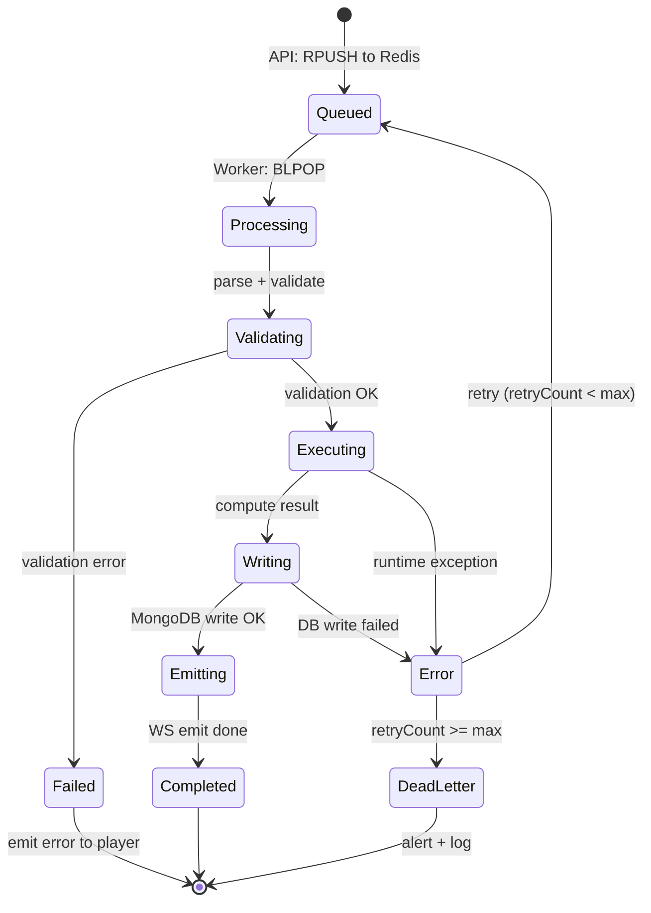

# BUNKER-disco — Worker System

> Версия: 1.0 | Дата: 2026-11-14

---

## Оглавление

1. [Принцип работы воркера](#1-принцип-работы-воркера)
2. [Типы задач](#2-типы-задач)
3. [Жизненный цикл задачи](#3-жизненный-цикл-задачи)
4. [Параллелизм и последовательность](#4-параллелизм-и-последовательность)
5. [Обработка ошибок и retry](#5-обработка-ошибок-и-retry)
6. [Псевдокод основных задач](#6-псевдокод-основных-задач)

---

## 1. Принцип работы воркера

### 1.1 Место в архитектуре

Worker — **единственный компонент, который изменяет состояние игры**. Ни API, ни клиенты не пишут напрямую в MongoDB. Вся игровая логика сосредоточена здесь.

```
API → Redis Queue → Worker → MongoDB + WebSocket
        (хранит)    (логика)   (пишет)   (эмитит)
```

### 1.2 Запуск

Воркер запускается как отдельный Node.js-процесс (не часть API-сервера):

```bash
# Запуск воркер-процесса
node worker/index.js

# В продакшне — через PM2 с cluster mode
pm2 start worker/index.js -i max --name bunker-worker
```

### 1.3 Как Worker «слушает» очереди

Используется `BLPOP` (Blocking Left POP) — Redis-команда, которая блокирует соединение до появления элемента в списке. Это эффективнее polling-цикла: воркер «спит» и мгновенно просыпается при появлении задачи.

```javascript
// Упрощённая схема event loop воркера
while (true) {
  const [queueKey, rawTask] = await redis.blpop(queueKey, 0); // 0 = ждать вечно
  const task = JSON.parse(rawTask);
  await processTask(task);
}
```

### 1.4 Масштабирование

При большом количестве активных комнат Worker масштабируется горизонтально:

```
Worker Instance 1 → слушает bunker:room:ROOM_A, bunker:room:ROOM_B
Worker Instance 2 → слушает bunker:room:ROOM_C, bunker:room:ROOM_D
Worker Instance 3 → слушает bunker:global
```

Распределение комнат по инстансам регулируется через Redis Pub/Sub при создании новой комнаты.

---

## 2. Типы задач

Все задачи имеют единую базовую структуру:

```typescript
interface BaseTask {
  taskId: string;          // UUID v4
  type: TaskType;          // тип задачи
  roomId: string;          // ID комнаты
  playerId?: string;       // ID инициатора (если применимо)
  payload: object;         // данные задачи
  createdAt: string;       // ISO 8601
  retryCount: number;      // текущий счётчик попыток
  maxRetries: number;      // максимум попыток (default: 3)
  clientSequence?: number; // номер запроса от клиента (идемпотентность)
}
```

### 2.1 `GameAction` — действие игрока

Охватывает все пользовательские действия в реальном времени.

```typescript
interface GameActionTask extends BaseTask {
  type: 'GameAction';
  payload: {
    action: GameActionType; // REVEAL_CARD, CAST_VOTE, USE_ABILITY, ...
    [key: string]: any;     // доп. данные специфичные для action
  };
}
```

**Подтипы action:**

| action | Описание | Фаза |
|--------|----------|------|
| `REVEAL_CARD` | Открыть карточку персонажа | Фаза 1 |
| `NOMINATE_PLAYER` | Выдвинуть на голосование | Фаза 1 |
| `CAST_VOTE` | Проголосовать | Фаза 1 |
| `SKIP_VOTE` | Пропустить голосование | Фаза 1 |
| `END_TURN` | Завершить ход | Фаза 1 |
| `ASSIGN_ROOM` | Назначить в комнату бункера | Фаза 2 |
| `TRADE_ITEM` | Передать предмет | Фаза 2 |
| `UPDATE_ROOM_SETTINGS` | Изменить настройки | Лобби |
| `KICK_PLAYER` | Кикнуть игрока | Лобби |

---

### 2.2 `PhaseTransition` — переход между фазами

Запускается автоматически воркером или по команде хоста.

```typescript
interface PhaseTransitionTask extends BaseTask {
  type: 'PhaseTransition';
  payload: {
    fromPhase: 'lobby' | 'phase1' | 'phase2';
    toPhase: 'phase1' | 'phase2' | 'ended';
    trigger: 'host' | 'auto' | 'condition_met';
  };
}
```

**Что делает обработчик:**
1. Проверяет корректность перехода (конечный автомат)
2. Раздаёт карточки персонажей (лобби → фаза 1)
3. Инициализирует состояние бункера (фаза 1 → фаза 2)
4. Финализирует результаты (фаза 2 → ended)
5. Эмитит `phase1_start` / `phase2_start` / `game_over`

---

### 2.3 `EventTrigger` — случайное событие

Создаётся внутренним планировщиком воркера по расписанию или условию.

```typescript
interface EventTriggerTask extends BaseTask {
  type: 'EventTrigger';
  payload: {
    eventTemplateId: string;    // ID шаблона из cards.events
    trigger: 'scheduled' | 'condition' | 'chain'; // причина триггера
    day?: number;               // игровой день (фаза 2)
    chainedFromEventId?: string; // если это цепочка событий
  };
}
```

**Что делает обработчик:**
1. Выбирает случайное событие из пула (с учётом редкости и уже прошедших)
2. Создаёт инстанс события в MongoDB
3. Определяет, кто принимает решение (все / конкретный игрок по карточке)
4. Эмитит `event_triggered` + `event_choice_required`
5. Добавляет `EventTimeout` задачу (если есть дедлайн выбора)

---

### 2.4 `ResourceUpdate` — обновление ресурсов

Регулярное (каждый тик дня) или разовое изменение ресурсов бункера.

```typescript
interface ResourceUpdateTask extends BaseTask {
  type: 'ResourceUpdate';
  payload: {
    trigger: 'day_tick' | 'event' | 'player_action' | 'craft';
    changes: {
      food?: number;
      water?: number;
      air?: number;
      medicine?: number;
      morale?: number;
      power?: number;
    };
    day: number;
  };
}
```

**Что делает обработчик:**
1. Читает текущие ресурсы из MongoDB
2. Применяет изменения с учётом модификаторов (профессии, комнаты)
3. Проверяет критические условия (ресурс ≤ 0 → событие голода/жажды/удушья)
4. Пишет обновлённые ресурсы в MongoDB
5. Эмитит `resource_update`

---

### 2.5 `CraftAction` — крафт предмета

```typescript
interface CraftActionTask extends BaseTask {
  type: 'CraftAction';
  payload: {
    action: 'start' | 'complete' | 'cancel';
    recipeId: string;
    craftInstanceId?: string; // для complete/cancel
  };
}
```

**Старт крафта:**
1. Проверить рецепт и наличие материалов
2. Списать материалы из инвентаря игрока
3. Создать `craft_instance` в MongoDB со статусом `in_progress`
4. Запланировать `CraftAction(complete)` через N тиков
5. Эмитит `craft_started`

**Завершение крафта:**
1. Обновить `craft_instance` → `completed`
2. Добавить предмет в инвентарь игрока
3. Эмитит `craft_complete`

---

### 2.6 `VoteAction` — управление голосованием

Отдельный тип для событий голосования, которые имеют собственный lifecycle.

```typescript
interface VoteActionTask extends BaseTask {
  type: 'VoteAction';
  payload: {
    action: 'start' | 'cast' | 'timeout' | 'tally';
    nomineeId?: string;
    voterId?: string;
    vote?: boolean;
    voteSessionId?: string;
  };
}
```

**`start`:** Создаёт vote session, устанавливает таймер, эмитит `vote_started`  
**`cast`:** Записывает голос, если все проголосовали — триггерит `tally`  
**`timeout`:** Если время истекло — триггерит `tally` с неполными голосами  
**`tally`:** Подсчитывает голоса, определяет результат, эмитит `vote_result`

---

### 2.7 `AbilityAction` — активная способность профессии

```typescript
interface AbilityActionTask extends BaseTask {
  type: 'AbilityAction';
  payload: {
    abilityId: string;
    targetPlayerId?: string;
    targetRoomType?: string;
    parameters?: Record<string, any>;
  };
}
```

**Что делает обработчик:**
1. Загружает данные профессии игрока
2. Проверяет кулдаун (`cooldownRemaining === 0`)
3. Проверяет требования (фаза, ход, наличие цели)
4. Выполняет эффект способности (модульная система handlers)
5. Устанавливает кулдаун
6. Эмитит `ability_used` + специфичные эффекты

---

## 3. Жизненный цикл задачи



### 3.1 Шаги обработки

```
1. DEQUEUE     — Worker забирает задачу из Redis (BLPOP)
2. PARSE       — JSON.parse + TypeScript type assertion
3. VALIDATE    — проверка прав, фазы игры, состояния игрока
4. IDEMPOTENCY — проверка clientSequence (не обработана ли уже?)
5. LOAD STATE  — чтение нужных данных из MongoDB
6. EXECUTE     — применение игровой логики
7. WRITE       — атомарная запись результата в MongoDB
8. EMIT        — emit WebSocket событий
9. DONE        — задача завершена
```

### 3.2 Идемпотентность

Для защиты от дублирования при реконнекте:

```javascript
// Перед обработкой
const lastSeq = await redis.hget(`bunker:room:${roomId}:meta`, `seq:${playerId}`);
if (task.clientSequence <= lastSeq) {
  console.log('Duplicate task, skipping:', task.taskId);
  return; // пропускаем
}

// После успешной обработки
await redis.hset(`bunker:room:${roomId}:meta`, `seq:${playerId}`, task.clientSequence);
```

---

## 4. Параллелизм и последовательность

### 4.1 Последовательность внутри комнаты

**Правило:** Задачи одной комнаты обрабатываются строго одна за другой.

**Почему это критично для игры:**

```
Пример race condition без последовательности:
  → Игрок А голосует за изгнание Б: читает state (Б жив)
  → Игрок Б использует способность: читает state (Б жив)
  → Игрок А пишет: Б изгнан
  → Игрок Б пишет: способность активирована (Б уже изгнан — противоречие!)
  
С последовательностью:
  → Голосование обрабатывается: Б изгнан
  → Способность обрабатывается: проверка → Б изгнан → отклонено
```

**Реализация:**

```javascript
class RoomWorker {
  private queue: Queue;    // per-room Redis queue
  private isProcessing = false;

  async run() {
    while (true) {
      const rawTask = await this.redis.blpop(this.queueKey, 30); // timeout 30s
      if (!rawTask) continue; // timeout, loop
      
      // НЕТ await на следующий цикл — сначала завершаем текущую задачу
      await this.processTask(JSON.parse(rawTask[1]));
      // только после этого BLPOP вызывается снова
    }
  }
}
```

### 4.2 Параллелизм между комнатами

Разные комнаты обрабатываются в полностью независимых асинхронных цепочках:

```javascript
class WorkerOrchestrator {
  private roomWorkers = new Map<string, RoomWorker>();

  async start() {
    // Слушаем создание новых комнат
    this.pubsub.subscribe('bunker:room:created', async (roomId) => {
      this.spawnRoomWorker(roomId);
    });

    // Слушаем завершение комнат
    this.pubsub.subscribe('bunker:room:ended', async (roomId) => {
      this.stopRoomWorker(roomId);
    });

    // Восстанавливаем воркеры для активных комнат при рестарте
    const activeRooms = await this.db.rooms.find({ status: { $ne: 'ended' } });
    activeRooms.forEach(room => this.spawnRoomWorker(room._id.toString()));
  }

  private spawnRoomWorker(roomId: string) {
    const worker = new RoomWorker(roomId, this.redis, this.db, this.io);
    this.roomWorkers.set(roomId, worker);
    worker.run(); // запускаем асинхронно, НЕ await
    console.log(`Room worker started: ${roomId}`);
  }
}
```

**Итоговая картина параллелизма:**

```
Node.js Event Loop (один поток)
    │
    ├── RoomWorker(ROOM_A): processing VoteAction      ← BLPOP returns
    ├── RoomWorker(ROOM_B): await MongoDB write         ← IO в полёте
    ├── RoomWorker(ROOM_C): emit WebSocket events       ← сеть
    ├── RoomWorker(ROOM_D): waiting for BLPOP           ← idle
    └── GlobalWorker:       scheduling day ticks        ← setInterval
```

Node.js справляется с этим без реальных потоков благодаря async/await + event loop.

### 4.3 Когда нужен distributed lock

Если Worker масштабируется на несколько инстансов (несколько процессов/машин), то нужен Redis-based distributed lock, чтобы два инстанса не взяли задачи одной комнаты:

```javascript
// Redis SETNX (set if not exists) для мьютекса
async function acquireRoomLock(roomId: string): Promise<boolean> {
  const lockKey = `bunker:lock:${roomId}`;
  const result = await redis.set(lockKey, workerId, 'NX', 'EX', 30); // 30s TTL
  return result === 'OK';
}

async function releaseRoomLock(roomId: string) {
  await redis.del(`bunker:lock:${roomId}`);
}
```

---

## 5. Обработка ошибок и retry

### 5.1 Категории ошибок

| Категория | Примеры | Поведение |
|-----------|---------|-----------|
| **Validation Error** | Неверная фаза, не ваш ход | Без retry, emit ошибку игроку |
| **Transient Error** | MongoDB timeout, сеть | Retry с backoff |
| **Logic Error** | Недостаточно ресурсов | Без retry, emit ошибку игроку |
| **Fatal Error** | Неизвестный тип задачи | Dead letter, alert |

### 5.2 Retry стратегия

```javascript
async function processWithRetry(task: BaseTask): Promise<void> {
  try {
    await processTask(task);
  } catch (error) {
    if (error instanceof ValidationError || error instanceof LogicError) {
      // Не ретраим — ошибка на стороне клиента
      await emitErrorToPlayer(task.roomId, task.playerId, error);
      return;
    }

    if (task.retryCount < task.maxRetries) {
      // Exponential backoff: 1s, 2s, 4s
      const delay = Math.pow(2, task.retryCount) * 1000;
      task.retryCount++;
      
      console.warn(`Task ${task.taskId} failed, retry ${task.retryCount}/${task.maxRetries} in ${delay}ms`);
      
      await sleep(delay);
      await redis.rpush(`bunker:room:${task.roomId}`, JSON.stringify(task));
    } else {
      // Dead letter
      await redis.rpush('bunker:dead_letter', JSON.stringify({
        ...task,
        failedAt: new Date().toISOString(),
        lastError: error.message,
      }));
      await alertOps(`Task dead-lettered: ${task.taskId}`, error);
    }
  }
}
```

### 5.3 Dead Letter Queue

Задачи, исчерпавшие попытки, попадают в `bunker:dead_letter`:

```javascript
// Отдельный монитор dead letter queue
async function monitorDeadLetter() {
  const task = await redis.lpop('bunker:dead_letter');
  if (task) {
    const parsed = JSON.parse(task);
    // Сохраняем в MongoDB для разбора
    await db.failedTasks.insertOne(parsed);
    // Уведомляем OPS (Slack, PagerDuty, etc.)
    await notify(`💀 Dead letter task: ${parsed.type} in room ${parsed.roomId}`);
  }
}
```

### 5.4 Таймаут задачи

Задача, которая не завершается за 30 секунд, считается зависшей:

```javascript
async function processTaskWithTimeout(task: BaseTask) {
  return Promise.race([
    processTask(task),
    new Promise((_, reject) =>
      setTimeout(() => reject(new Error('Task timeout')), 30_000)
    ),
  ]);
}
```

---

## 6. Псевдокод основных задач

### 6.1 `GameAction: REVEAL_CARD`

```javascript
async function handleRevealCard(task: GameActionTask, ctx: TaskContext) {
  const { roomId, playerId, payload } = task;
  const { cardType } = payload;

  // 1. Загружаем состояние
  const [gameState, player] = await Promise.all([
    ctx.db.game_state.findOne({ roomId }),
    ctx.db.players.findOne({ _id: playerId }),
  ]);

  // 2. Валидация
  if (gameState.phase !== 'phase1') throw new ValidationError('INVALID_PHASE');
  if (gameState.phase1.currentPlayerTurnId !== playerId) throw new ValidationError('NOT_YOUR_TURN');
  if (player.cards[cardType].isRevealed) throw new ValidationError('ALREADY_REVEALED');

  // 3. Получаем данные карточки
  const card = await ctx.db.cards.findOne({ _id: player.cards[cardType].cardId });

  // 4. Обновляем состояние (атомарно)
  await ctx.db.players.updateOne(
    { _id: playerId },
    { $set: { [`cards.${cardType}.isRevealed`]: true } }
  );

  // 5. Логируем действие
  await ctx.db.game_state.updateOne(
    { roomId },
    { $push: { actionLog: { actionType: 'REVEAL_CARD', playerId, payload: { cardType }, timestamp: new Date() } } }
  );

  // 6. Эмитим событие всем в комнате
  ctx.io.to(`room:${roomId}`).emit('card_revealed', {
    playerId,
    cardType,
    cardData: card,
  });
}
```

---

### 6.2 `VoteAction: tally` — подсчёт голосов

```javascript
async function handleVoteTally(task: VoteActionTask, ctx: TaskContext) {
  const { roomId, payload } = task;
  const { voteSessionId } = payload;

  // 1. Загружаем сессию голосования
  const gameState = await ctx.db.game_state.findOne({ roomId });
  const { votingState } = gameState.phase1;
  const { nomineeId, votes } = votingState;

  // 2. Подсчёт
  const votesFor = votes.filter(v => v.vote === true).length;
  const votesAgainst = votes.filter(v => v.vote === false).length;
  const totalVoters = votes.length;
  const eliminated = votesFor > totalVoters / 2; // простое большинство

  // 3. Обновляем состояние
  const update = { $set: { 'phase1.votingState.isActive': false } };
  if (eliminated) {
    update.$set['phase1.eliminatedPlayers'] = [...gameState.phase1.eliminatedPlayers, nomineeId];
    await ctx.db.players.updateOne({ _id: nomineeId }, { $set: { isEliminated: true } });
  }
  await ctx.db.game_state.updateOne({ roomId }, update);

  // 4. Эмитим результат
  ctx.io.to(`room:${roomId}`).emit('vote_result', {
    nomineeId, votesFor, votesAgainst, eliminated, tieBreak: false,
  });

  if (eliminated) {
    // Получаем все карточки изгнанного для финального раскрытия
    const nominee = await ctx.db.players.findOne({ _id: nomineeId });
    const allCards = await ctx.db.cards.find({
      _id: { $in: Object.values(nominee.cards).map(c => c.cardId) }
    }).toArray();

    ctx.io.to(`room:${roomId}`).emit('player_eliminated', {
      playerId: nomineeId,
      nickname: nominee.nickname,
      finalCards: allCards,
    });
  }

  // 5. Переходим к следующему ходу
  await ctx.redis.rpush(`bunker:room:${roomId}`, JSON.stringify({
    taskId: uuid(),
    type: 'GameAction',
    roomId,
    payload: { action: 'ADVANCE_TURN' },
    createdAt: new Date().toISOString(),
    retryCount: 0,
    maxRetries: 3,
  }));
}
```

---

### 6.3 `PhaseTransition: phase1 → phase2`

```javascript
async function handlePhaseTransition(task: PhaseTransitionTask, ctx: TaskContext) {
  const { roomId, payload } = task;
  const { fromPhase, toPhase } = payload;

  if (fromPhase !== 'phase1' || toPhase !== 'phase2') {
    throw new ValidationError('INVALID_TRANSITION');
  }

  // 1. Загружаем финальное состояние Фазы 1
  const gameState = await ctx.db.game_state.findOne({ roomId });
  const inBunkerIds = gameState.phase1.revealOrder
    .filter(id => !gameState.phase1.eliminatedPlayers.includes(id));

  // 2. Инициализируем Фазу 2
  const phase2State = {
    currentDay: 1,
    currentTick: 0,
    resources: {
      food: 100 * inBunkerIds.length,
      water: 80 * inBunkerIds.length,
      air: 100,
      medicine: 50,
      morale: 70,
      power: 90,
    },
    rooms: generateInitialBunkerRooms(inBunkerIds.length),
    activeEvents: [],
    dayLog: [],
  };

  // 3. Обновляем MongoDB
  await ctx.db.game_state.updateOne(
    { roomId },
    {
      $set: {
        phase: 'phase2',
        phase2: phase2State,
        updatedAt: new Date(),
      }
    }
  );
  await ctx.db.players.updateMany(
    { _id: { $in: inBunkerIds } },
    { $set: { isInBunker: true } }
  );

  // 4. Эмитим переход
  const players = await ctx.db.players.find({ _id: { $in: inBunkerIds } }).toArray();
  ctx.io.to(`room:${roomId}`).emit('phase2_start', {
    bunkerState: phase2State,
    players: players.map(p => ({ playerId: p._id, nickname: p.nickname, stats: p.stats })),
    day: 1,
    resources: phase2State.resources,
  });

  // 5. Планируем первый тик дня
  await scheduleDayTick(roomId, 1, ctx.redis);
}
```

---

### 6.4 `ResourceUpdate` — ежедневный тик ресурсов

```javascript
async function handleResourceUpdate(task: ResourceUpdateTask, ctx: TaskContext) {
  const { roomId, payload } = task;
  const { day, trigger } = payload;

  // 1. Загружаем текущее состояние
  const gameState = await ctx.db.game_state.findOne({ roomId });
  const { resources } = gameState.phase2;
  const activePlayers = await ctx.db.players.find({ roomId, isInBunker: true, health: { $gt: 0 } }).toArray();

  // 2. Вычисляем потребление (базовое × модификаторы от профессий/комнат)
  const consumption = computeDailyConsumption(activePlayers, gameState.phase2.rooms);

  // 3. Применяем изменения
  const newResources = {
    food: Math.max(0, resources.food - consumption.food + (payload.changes?.food ?? 0)),
    water: Math.max(0, resources.water - consumption.water + (payload.changes?.water ?? 0)),
    air: Math.max(0, resources.air - consumption.air + (payload.changes?.air ?? 0)),
    medicine: Math.max(0, resources.medicine + (payload.changes?.medicine ?? 0)),
    morale: clamp(resources.morale + computeMoraleDelta(gameState), 0, 100),
    power: Math.max(0, resources.power - consumption.power),
  };

  // 4. Пишем в MongoDB
  await ctx.db.game_state.updateOne(
    { roomId },
    { $set: { 'phase2.resources': newResources } }
  );

  // 5. Проверяем критические уровни
  const criticalEvents = [];
  if (newResources.food === 0) criticalEvents.push('FOOD_EXHAUSTED');
  if (newResources.water === 0) criticalEvents.push('WATER_EXHAUSTED');
  if (newResources.air < 20) criticalEvents.push('AIR_CRITICAL');
  if (newResources.morale < 15) criticalEvents.push('MORALE_COLLAPSE');

  // 6. Эмитим обновление ресурсов
  ctx.io.to(`room:${roomId}`).emit('resource_update', {
    ...newResources,
    delta: {
      food: newResources.food - resources.food,
      water: newResources.water - resources.water,
    },
  });

  // 7. Триггерим критические события
  for (const eventId of criticalEvents) {
    await ctx.redis.rpush(`bunker:room:${roomId}`, JSON.stringify({
      taskId: uuid(),
      type: 'EventTrigger',
      roomId,
      payload: { eventTemplateId: eventId, trigger: 'condition', day },
      createdAt: new Date().toISOString(),
      retryCount: 0, maxRetries: 3,
    }));
  }
}
```

---

### 6.5 `AbilityAction` — активная способность

```javascript
async function handleAbilityAction(task: AbilityActionTask, ctx: TaskContext) {
  const { roomId, playerId, payload } = task;
  const { abilityId, targetPlayerId } = payload;

  // 1. Загружаем игрока
  const player = await ctx.db.players.findOne({ _id: playerId });
  const abilityState = player.abilities.find(a => a.abilityId === abilityId);
  
  if (!abilityState) throw new ValidationError('ABILITY_NOT_FOUND');
  if (abilityState.cooldownRemaining > 0) throw new ValidationError('ABILITY_ON_COOLDOWN');

  // 2. Выбираем handler по abilityId (стратегия паттерн)
  const handler = abilityHandlers[abilityId];
  if (!handler) throw new FatalError(`No handler for ability: ${abilityId}`);

  // 3. Выполняем способность
  const result = await handler.execute({
    player, targetPlayerId, roomId, ctx
  });

  // 4. Устанавливаем кулдаун
  const card = await ctx.db.cards.findOne({ 'professionData.activeAbility': { $exists: true } });
  const cooldown = card?.professionData?.activeAbility?.cooldown ?? 1;

  await ctx.db.players.updateOne(
    { _id: playerId, 'abilities.abilityId': abilityId },
    { $set: { 'abilities.$.cooldownRemaining': cooldown } }
  );

  // 5. Эмитим
  ctx.io.to(`room:${roomId}`).emit('ability_used', {
    playerId,
    abilityId,
    abilityName: handler.name,
    targetId: targetPlayerId,
    effect: result.publicEffect,
  });

  // Персональные эффекты (если есть)
  if (result.privateEffect && targetPlayerId) {
    ctx.io.to(`room:${roomId}:player:${targetPlayerId}`).emit('player_stat_update', result.privateEffect);
  }
}
```

---

## Сводка: Worker в одной таблице

| Задача | Триггер | Последствия |
|--------|---------|-------------|
| `GameAction` | Игрок → POST /actions | Изменение игровых объектов |
| `PhaseTransition` | Хост / авто | Смена фазы игры |
| `EventTrigger` | Планировщик / условие | Новое событие в игре |
| `ResourceUpdate` | Тик дня / событие | Изменение ресурсов бункера |
| `CraftAction` | Игрок / таймер | Создание предмета |
| `VoteAction` | Голосование / таймер | Результат голосования |
| `AbilityAction` | Игрок | Эффект способности |
