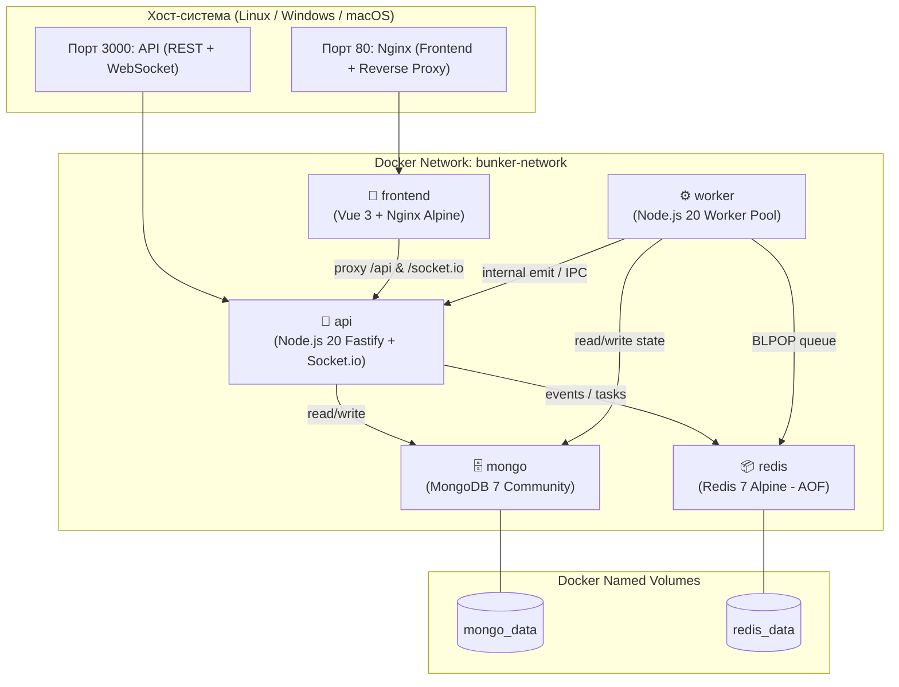

# BUNKER-disco — Docker Deployment Guide

> Версия: 1.0 | Дата: 2026-11-14 | Назначение: Автоматическое развёртывание всего стека одной командой

---

## 1. Архитектура контейнеров

Система BUNKER-disco разворачивается в виде изолированного мультиконтейнерного стека через **Docker Compose v2**. Все сервисы объединены в общую виртуальную сеть с персистентными хранилищами (volumes) и строгими healthcheck-проверками порядка запуска.



---

## 2. Быстрый старт (Quick Start)

Развёртывание всего стека выполняется одной командой:

```bash
# 1. Клонирование репозитория
git clone https://github.com/your-org/bunker-disco.git
cd bunker-disco

# 2. Создание файла переменных окружения из шаблона
cp .env.example .env

# 3. Запуск всех сервисов в фоновом режиме
docker compose up -d --build

# 4. Проверка статуса контейнеров и логов
docker compose ps
docker compose logs -f
```

После старта интерфейс доступен:
- **BigScreen (Большой экран / TV):** `http://localhost/screen`
- **PlayerScreen (Игроки с телефонов/ПК):** `http://localhost/play` или `http://<IP-вашего-сервера>/play`
- **REST API & Swagger:** `http://localhost:3000/api/v1`
- **Health Check:** `http://localhost:3000/api/v1/health`

---

## 3. Файл `docker-compose.yml`

Готовый продакшн-манифест с настроенными политиками перезапуска, лимитами ресурсов, healthcheck'ами и зависимостями (`depends_on: condition: service_healthy`):

```yaml
version: '3.8'

services:
  # ==========================================
  # База данных MongoDB
  # ==========================================
  mongo:
    image: mongo:7.0-jammy
    container_name: bunker-mongo
    restart: always
    environment:
      MONGO_INITDB_ROOT_USERNAME: ${MONGO_ROOT_USER:-bunker_admin}
      MONGO_INITDB_ROOT_PASSWORD: ${MONGO_ROOT_PASSWORD:-bunker_secret_pass}
      MONGO_INITDB_DATABASE: ${MONGO_DB_NAME:-bunker_disco}
    volumes:
      - mongo_data:/data/db
      - ./docker/mongo/init-mongo.js:/docker-entrypoint-initdb.d/init-mongo.js:ro
    networks:
      - bunker-network
    healthcheck:
      test: ["CMD-SHELL", "mongosh --eval 'db.adminCommand(\"ping\")' -u $$MONGO_INITDB_ROOT_USERNAME -p $$MONGO_INITDB_ROOT_PASSWORD --quiet"]
      interval: 10s
      timeout: 5s
      retries: 5
      start_period: 15s
    deploy:
      resources:
        limits:
          cpus: '1.5'
          memory: 1024M

  # ==========================================
  # Redis (Очередь задач и Pub/Sub)
  # ==========================================
  redis:
    image: redis:7.2-alpine
    container_name: bunker-redis
    restart: always
    command: ["redis-server", "--appendonly", "yes", "--requirepass", "${REDIS_PASSWORD:-bunker_redis_pass}"]
    volumes:
      - redis_data:/data
    networks:
      - bunker-network
    healthcheck:
      test: ["CMD", "redis-cli", "-a", "${REDIS_PASSWORD:-bunker_redis_pass}", "ping"]
      interval: 10s
      timeout: 3s
      retries: 5
      start_period: 5s
    deploy:
      resources:
        limits:
          cpus: '1.0'
          memory: 512M

  # ==========================================
  # REST API & WebSocket Сервер
  # ==========================================
  api:
    build:
      context: .
      dockerfile: docker/api/Dockerfile
    container_name: bunker-api
    restart: always
    environment:
      NODE_ENV: production
      PORT: 3000
      MONGO_URI: mongodb://${MONGO_ROOT_USER:-bunker_admin}:${MONGO_ROOT_PASSWORD:-bunker_secret_pass}@mongo:27017/${MONGO_DB_NAME:-bunker_disco}?authSource=admin
      REDIS_HOST: redis
      REDIS_PORT: 6379
      REDIS_PASSWORD: ${REDIS_PASSWORD:-bunker_redis_pass}
      JWT_SECRET: ${JWT_SECRET:-super_secret_jwt_key_bunker_disco_2026}
      CORS_ORIGIN: ${CORS_ORIGIN:-*}
    ports:
      - "3000:3000"
    depends_on:
      mongo:
        condition: service_healthy
      redis:
        condition: service_healthy
    networks:
      - bunker-network
    healthcheck:
      test: ["CMD-SHELL", "wget -qO- http://localhost:3000/api/v1/health || exit 1"]
      interval: 10s
      timeout: 5s
      retries: 3
      start_period: 10s
    deploy:
      resources:
        limits:
          cpus: '2.0'
          memory: 1024M

  # ==========================================
  # Фоновый обработчик игровой логики (Worker)
  # ==========================================
  worker:
    build:
      context: .
      dockerfile: docker/worker/Dockerfile
    container_name: bunker-worker
    restart: always
    environment:
      NODE_ENV: production
      MONGO_URI: mongodb://${MONGO_ROOT_USER:-bunker_admin}:${MONGO_ROOT_PASSWORD:-bunker_secret_pass}@mongo:27017/${MONGO_DB_NAME:-bunker_disco}?authSource=admin
      REDIS_HOST: redis
      REDIS_PORT: 6379
      REDIS_PASSWORD: ${REDIS_PASSWORD:-bunker_redis_pass}
      WORKER_CONCURRENCY: ${WORKER_CONCURRENCY:-10}
    depends_on:
      mongo:
        condition: service_healthy
      redis:
        condition: service_healthy
    networks:
      - bunker-network
    healthcheck:
      test: ["CMD-SHELL", "node -e 'require(\"process\").exit(0)'"]
      interval: 30s
      timeout: 5s
      retries: 3
    deploy:
      resources:
        limits:
          cpus: '2.0'
          memory: 1024M

  # ==========================================
  # Frontend (Vue 3 + Three.js + Nginx Proxy)
  # ==========================================
  frontend:
    build:
      context: .
      dockerfile: docker/frontend/Dockerfile
      args:
        VITE_API_URL: ${VITE_API_URL:-http://localhost:3000}
        VITE_WS_URL: ${VITE_WS_URL:-ws://localhost:3000}
    container_name: bunker-frontend
    restart: always
    ports:
      - "80:80"
      - "443:443"
    depends_on:
      api:
        condition: service_healthy
    networks:
      - bunker-network
    healthcheck:
      test: ["CMD-SHELL", "wget -qO- http://localhost:80/ || exit 1"]
      interval: 15s
      timeout: 5s
      retries: 3
    deploy:
      resources:
        limits:
          cpus: '1.0'
          memory: 512M

# ==========================================
# Сети и тома
# ==========================================
networks:
  bunker-network:
    name: bunker-network
    driver: bridge

volumes:
  mongo_data:
    name: bunker_mongo_data
  redis_data:
    name: bunker_redis_data
```

---

## 4. Dockerfile сервисов

### 4.1 Backend (API & Worker: Multi-stage Build)

Поскольку `api` и `worker` используют общую кодовую базу (модели TypeScript, схемы валидации, игровую логику), они собираются из универсального мультистейдж Dockerfile.

#### `docker/api/Dockerfile`
```dockerfile
# ----------------------------------------------------
# Stage 1: Build & Dependencies
# ----------------------------------------------------
FROM node:20-alpine AS builder

WORKDIR /app

# Установка зависимостей сборки
RUN apk add --no-cache python3 make g++

COPY package*.json ./
COPY tsconfig*.json ./

RUN npm ci

COPY src/ ./src/

# Компиляция TypeScript
RUN npm run build

# ----------------------------------------------------
# Stage 2: Production Runtime
# ----------------------------------------------------
FROM node:20-alpine AS runner

WORKDIR /app

ENV NODE_ENV=production

# Установка wget для healthcheck
RUN apk add --no-cache wget

COPY package*.json ./
RUN npm ci --only=production && npm cache clean --force

COPY --from=builder /app/dist ./dist

# Безопасность: запуск от непривилегированного пользователя node
USER node

EXPOSE 3000

CMD ["node", "dist/server.js"]
```

#### `docker/worker/Dockerfile`
```dockerfile
# ----------------------------------------------------
# Stage 1: Build
# ----------------------------------------------------
FROM node:20-alpine AS builder

WORKDIR /app

RUN apk add --no-cache python3 make g++

COPY package*.json ./
COPY tsconfig*.json ./

RUN npm ci

COPY src/ ./src/

RUN npm run build

# ----------------------------------------------------
# Stage 2: Production Worker Runtime
# ----------------------------------------------------
FROM node:20-alpine AS runner

WORKDIR /app

ENV NODE_ENV=production

COPY package*.json ./
RUN npm ci --only=production && npm cache clean --force

COPY --from=builder /app/dist ./dist

USER node

CMD ["node", "dist/worker/index.js"]
```

---

### 4.2 Frontend (Vue 3 + Three.js + Nginx)

#### `docker/frontend/Dockerfile`
```dockerfile
# ----------------------------------------------------
# Stage 1: Сборка Vue 3 + Vite + Three.js
# ----------------------------------------------------
FROM node:20-alpine AS builder

WORKDIR /app

COPY package*.json ./
RUN npm ci

COPY . .

# Передача переменных окружения на этапе сборки Vite
ARG VITE_API_URL
ARG VITE_WS_URL
ENV VITE_API_URL=$VITE_API_URL
ENV VITE_WS_URL=$VITE_WS_URL

RUN npm run build

# ----------------------------------------------------
# Stage 2: Раздача статики через Nginx Alpine
# ----------------------------------------------------
FROM nginx:1.25-alpine

# Копирование скомпилированного SPA
COPY --from=builder /app/dist /usr/share/nginx/html

# Пользовательская конфигурация Nginx с поддержкой SPA-роутинга и проксирования
COPY docker/frontend/nginx.conf /etc/nginx/conf.d/default.conf

EXPOSE 80 443

HEALTHCHECK --interval=15s --timeout=5s --retries=3 \
  CMD wget -qO- http://localhost:80/ || exit 1

CMD ["nginx", "-g", "daemon off;"]
```

#### `docker/frontend/nginx.conf`
```nginx
server {
    listen 80;
    server_name localhost;

    # Gzip сжатие для ассетов Three.js, воксельных сеток и пиксельных шрифтов
    gzip on;
    gzip_vary on;
    gzip_min_length 1024;
    gzip_proxied expired no-cache no-store private auth;
    gzip_types text/plain text/css text/xml text/javascript application/x-javascript application/xml application/javascript application/json font/woff2;

    # Корневая папка статики
    location / {
        root /usr/share/nginx/html;
        index index.html index.htm;
        try_files $uri $uri/ /index.html;
    }

    # Кэширование пиксельных шрифтов и звуковых файлов (SFX)
    location ~* \.(woff2|woff|ttf|ogg|mp3|wav|png|jpg|svg)$ {
        root /usr/share/nginx/html;
        expires 30d;
        add_header Cache-Control "public, no-transform";
    }

    # Проксирование REST API к бэкенду
    location /api/ {
        proxy_pass http://api:3000/api/;
        proxy_http_version 1.1;
        proxy_set_header Host $host;
        proxy_set_header X-Real-IP $remote_addr;
        proxy_set_header X-Forwarded-For $proxy_add_x_forwarded_for;
        proxy_set_header X-Forwarded-Proto $scheme;
    }

    # Проксирование WebSocket соединений Socket.io
    location /socket.io/ {
        proxy_pass http://api:3000/socket.io/;
        proxy_http_version 1.1;
        proxy_set_header Upgrade $http_upgrade;
        proxy_set_header Connection "upgrade";
        proxy_set_header Host $host;
        proxy_set_header X-Real-IP $remote_addr;
        proxy_set_header X-Forwarded-For $proxy_add_x_forwarded_for;
        proxy_read_timeout 86400s;
        proxy_send_timeout 86400s;
    }
}
```

---

## 5. Переменные окружения (`.env`)

Создайте файл `.env` в корне проекта (на основе приведенного ниже примера):

```ini
# ===================================================
# BUNKER-disco Environment Configuration
# ===================================================

# Окружение
NODE_ENV=production

# ---------------------------------------------------
# MongoDB Configuration
# ---------------------------------------------------
MONGO_ROOT_USER=bunker_admin
MONGO_ROOT_PASSWORD=SuperSecretMongoPassword2026!
MONGO_DB_NAME=bunker_disco
MONGO_PORT=27017

# ---------------------------------------------------
# Redis Configuration
# ---------------------------------------------------
REDIS_PASSWORD=SuperSecretRedisPassword2026!
REDIS_PORT=6379

# ---------------------------------------------------
# Security & JWT
# ---------------------------------------------------
JWT_SECRET=bunker_jwt_secret_ultra_key_random_hex_64_symbols_a98f12d4
CORS_ORIGIN=*

# ---------------------------------------------------
# Worker Settings
# ---------------------------------------------------
WORKER_CONCURRENCY=10
TASK_TIMEOUT_MS=30000

# ---------------------------------------------------
# Public URLs (для клиентов и телефонов)
# В локальной сети укажите IP вашего хоста: например, http://192.168.1.100
# ---------------------------------------------------
VITE_API_URL=http://localhost:3000
VITE_WS_URL=ws://localhost:3000
```

---

## 6. Базовый скрипт инициализации MongoDB

Файл `docker/mongo/init-mongo.js` автоматически запускается при первом старте контейнера MongoDB и настраивает необходимые уникальные и TTL-индексы:

```javascript
// docker/mongo/init-mongo.js
db = db.getSiblingDB('bunker_disco');

// Индекс для мгновенного поиска комнаты по 5-значному коду
db.rooms.createIndex({ "code": 1 }, { unique: true });

// TTL индекс: автоудаление завершённых комнат через 24 часа
db.rooms.createIndex({ "expiresAt": 1 }, { expireAfterSeconds: 0 });

// Индексы для игроков
db.players.createIndex({ "roomId": 1, "nickname": 1 });
db.players.createIndex({ "token": 1 });

// Индексы состояния игры
db.game_state.createIndex({ "roomId": 1 }, { unique: true });

// Индекс карточек по строковому идентификатору
db.cards.createIndex({ "cardId": 1 }, { unique: true });
db.cards.createIndex({ "type": 1, "tags": 1 });

print(">>> [MongoDB Init] BUNKER-disco indexes initialized successfully.");
```

---

## 7. Полезные команды управления (Cheat Sheet)

```bash
# Запуск / Пересборка
docker compose up -d --build

# Остановка контейнеров без удаления данных
docker compose stop

# Перезапуск контейнеров
docker compose restart

# Просмотр логов конкретного сервиса (например, воркера игровой логики)
docker compose logs -f worker

# Просмотр статуса здоровья (healthcheck)
docker compose ps

# Вход внутрь контейнера API для отладки
docker compose exec api sh

# Вход в консоль Redis CLI
docker compose exec redis redis-cli -a SuperSecretRedisPassword2026!

# Вход в консоль MongoDB
docker compose exec mongo mongosh -u bunker_admin -p SuperSecretMongoPassword2026! --authenticationDatabase admin

# Полная очистка окружения (ВНИМАНИЕ: удалит базы данных в volumes!)
docker compose down -v
```
